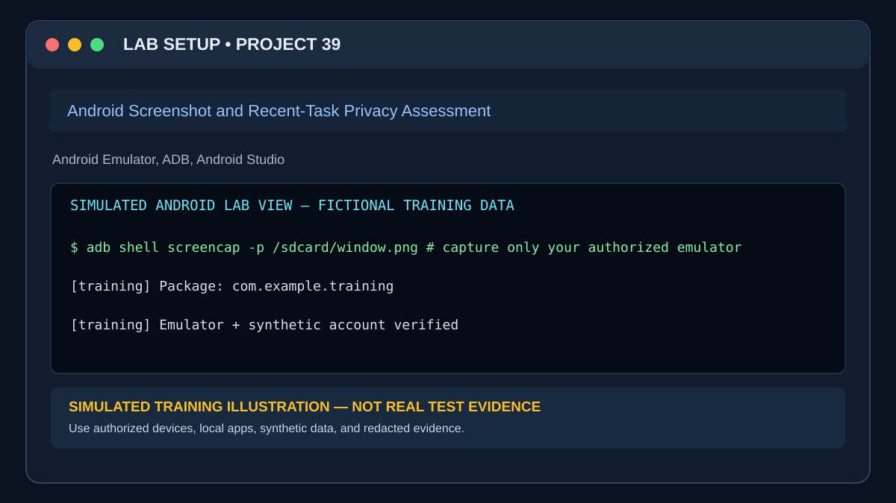
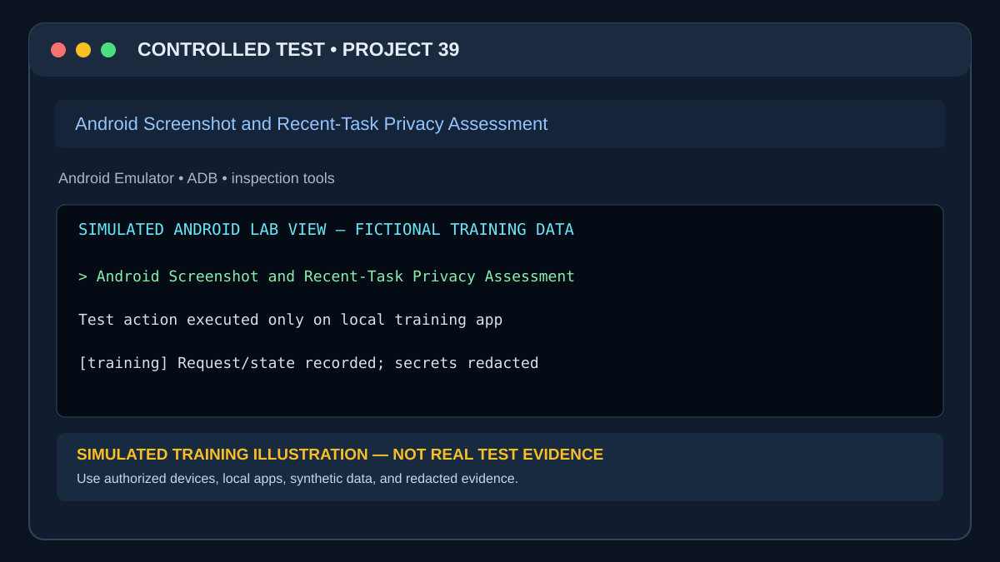
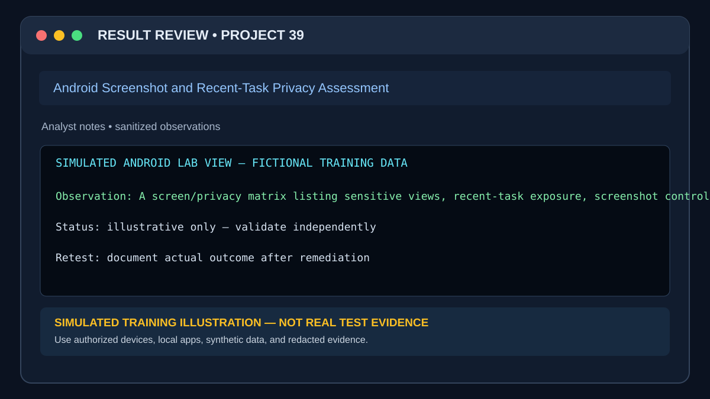

# 39. Android Screenshot and Recent-Task Privacy Assessment

<sub><b>ADVANCED</b> · Android mobile application security testing</sub>

> **SIMULATED TRAINING WALKTHROUGH — NOT REAL TEST EVIDENCE.** Images and sample observations are fictional UI illustrations. Perform tests only in an isolated lab you control or under written authorization.

## Objective

Evaluate whether sensitive screens are exposed through screenshots, recent-task previews, screen recording, or app-switcher snapshots.

## Lab and prerequisites

- Dedicated Android Studio Emulator or test device with disposable profile and snapshot.
- Training APK, synthetic data, and a host-only test network.
- **Tools:** Android Emulator, ADB, Android Studio.
- Confirm scope, package/build hash, device/API level, account roles, tool versions, test window, and stop conditions.
- Advanced testing must not touch production accounts, real user data, or third-party applications.

## Step 1 — Baseline and target verification

Record package identity, APK SHA-256, signing/build details, device serial, Android API level, and normal app behavior. Confirm the target package before running commands.

```bash
adb devices -l
adb shell getprop ro.build.version.release
adb shell pm list packages | grep -F 'com.example.training'
```

## Step 2 — Inspect the implementation

Use the listed tools to map the relevant manifest declarations, code paths, native components, data stores, or platform behavior. Record class/method/file references and identify the expected security property. Preserve an untouched APK copy and emulator snapshot.

## Step 3 — Controlled assessment procedure

1. Identify screens containing synthetic sensitive data such as account details or recovery codes.
2. Observe recent-task previews during normal background/foreground transitions.
3. Review FLAG_SECURE usage and screen lifecycle handling for sensitive views.
4. Capture emulator screenshots only from the lab and verify that protected content is masked where required.
5. Check accessibility and legitimate support workflows to avoid blocking users unnecessarily.

Example lab command:

```bash
adb shell screencap -p /sdcard/window.png  # capture only your authorized emulator
```

Adapt it to the test APK and tool version. Do not execute against unrelated devices, services, or accounts. Stop if the test affects data outside the agreed scope.

## Step 4 — Expected observations and validation

A screen/privacy matrix listing sensitive views, recent-task exposure, screenshot controls, and UX trade-offs.

Sensitive data may remain visible in task previews or screenshots after the app is backgrounded. Validate the observation against source/configuration, runtime behavior, attacker prerequisites, and actual data/action impact. Distinguish confirmed behavior from theoretical attack paths, tool alerts, and false positives.

## Step 5 — Remediation and retest

Apply FLAG_SECURE selectively, clear sensitive views before backgrounding, mask high-risk content, and avoid retaining secrets on screen.

Retest the corrected build with the same device/API level and equivalent test conditions. Record build hashes, timestamps, before/after results, residual risk, and any platform-specific limitations.

## Simulated tool screenshots

> These project-specific images are fictional training illustrations, not actual ADB/JADX/MobSF/Frida output or evidence of a real assessment.







## Evidence and deliverables

- Authorization, scope, exclusions, and stop conditions.
- APK/build hash, package, device/API level, tool versions, and test identities.
- Reproducible commands/actions, source references, timestamps, and sanitized logs/screenshots.
- Expected versus observed behavior, validated impact, confidence, and limitations.
- Remediation owner, retest evidence, and residual risk. Keep secrets and private APKs out of Git.

## Framework references

- OWASP MASVS-PRIVACY; Android Developers — FLAG_SECURE
- [OWASP MASVS](https://mas.owasp.org/MASVS/)
- [OWASP MASTG](https://mas.owasp.org/MASTG/)

## Completion checklist

- [ ] Written scope and authorization confirmed
- [ ] Isolated device, app, and synthetic data prepared
- [ ] Static/dynamic test performed safely
- [ ] Evidence sanitized and labeled
- [ ] Impact independently validated
- [ ] Remediation and retest documented
