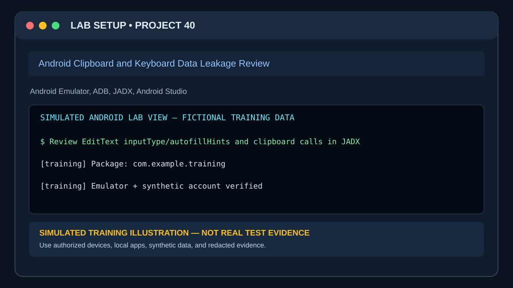
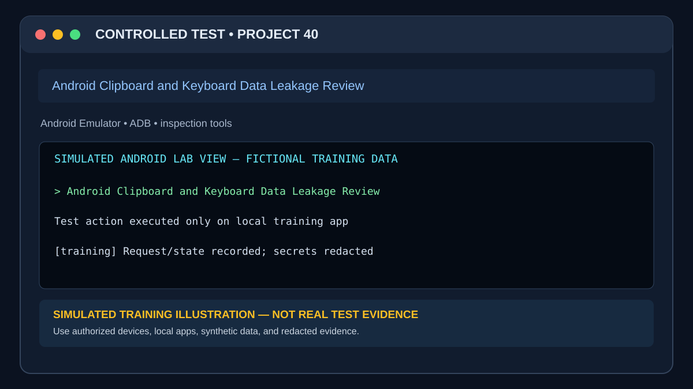
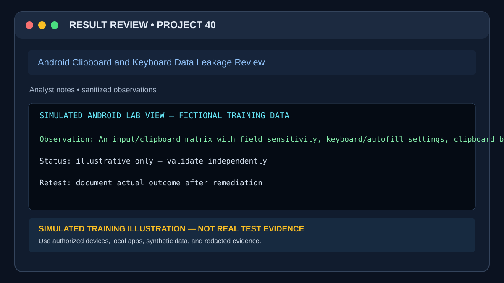

# 40. Android Clipboard and Keyboard Data Leakage Review

<sub><b>ADVANCED</b> · Android mobile application security testing</sub>

> **SIMULATED TRAINING WALKTHROUGH — NOT REAL TEST EVIDENCE.** Images and sample observations are fictional UI illustrations. Perform tests only in an isolated lab you control or under written authorization.

## Objective

Review clipboard copying, autofill, keyboard suggestions, and input-field configuration for sensitive data exposure.

## Lab and prerequisites

- Dedicated Android Studio Emulator or test device with disposable profile and snapshot.
- Training APK, synthetic data, and a host-only test network.
- **Tools:** Android Emulator, ADB, JADX, Android Studio.
- Confirm scope, package/build hash, device/API level, account roles, tool versions, test window, and stop conditions.
- Advanced testing must not touch production accounts, real user data, or third-party applications.

## Step 1 — Baseline and target verification

Record package identity, APK SHA-256, signing/build details, device serial, Android API level, and normal app behavior. Confirm the target package before running commands.

```bash
adb devices -l
adb shell getprop ro.build.version.release
adb shell pm list packages | grep -F 'com.example.training'
```

## Step 2 — Inspect the implementation

Use the listed tools to map the relevant manifest declarations, code paths, native components, data stores, or platform behavior. Record class/method/file references and identify the expected security property. Preserve an untouched APK copy and emulator snapshot.

## Step 3 — Controlled assessment procedure

1. Inventory password, payment, recovery, and other sensitive input fields.
2. Review inputType, autofillHints, textIsSelectable, clipboard use, and copy/paste UX.
3. Use synthetic values to test whether secrets are copied or exposed to unintended app contexts.
4. Check whether sensitive fields permit personalized keyboard learning or suggestions where policy requires restrictions.
5. Verify sensitive clipboard values are cleared or time-limited where the platform supports it.

Example lab command:

```bash
Review EditText inputType/autofillHints and clipboard calls in JADX
```

Adapt it to the test APK and tool version. Do not execute against unrelated devices, services, or accounts. Stop if the test affects data outside the agreed scope.

## Step 4 — Expected observations and validation

An input/clipboard matrix with field sensitivity, keyboard/autofill settings, clipboard behavior, and user impact.

Sensitive values may leak through clipboard history, keyboard learning, autofill providers, or screenshots. Validate the observation against source/configuration, runtime behavior, attacker prerequisites, and actual data/action impact. Distinguish confirmed behavior from theoretical attack paths, tool alerts, and false positives.

## Step 5 — Remediation and retest

Use appropriate input types and autofill controls, minimize clipboard use, clear sensitive values where feasible, and communicate privacy trade-offs.

Retest the corrected build with the same device/API level and equivalent test conditions. Record build hashes, timestamps, before/after results, residual risk, and any platform-specific limitations.

## Simulated tool screenshots

> These project-specific images are fictional training illustrations, not actual ADB/JADX/MobSF/Frida output or evidence of a real assessment.







## Evidence and deliverables

- Authorization, scope, exclusions, and stop conditions.
- APK/build hash, package, device/API level, tool versions, and test identities.
- Reproducible commands/actions, source references, timestamps, and sanitized logs/screenshots.
- Expected versus observed behavior, validated impact, confidence, and limitations.
- Remediation owner, retest evidence, and residual risk. Keep secrets and private APKs out of Git.

## Framework references

- OWASP MASVS-PRIVACY; Android Developers — Autofill Framework
- [OWASP MASVS](https://mas.owasp.org/MASVS/)
- [OWASP MASTG](https://mas.owasp.org/MASTG/)

## Completion checklist

- [ ] Written scope and authorization confirmed
- [ ] Isolated device, app, and synthetic data prepared
- [ ] Static/dynamic test performed safely
- [ ] Evidence sanitized and labeled
- [ ] Impact independently validated
- [ ] Remediation and retest documented
