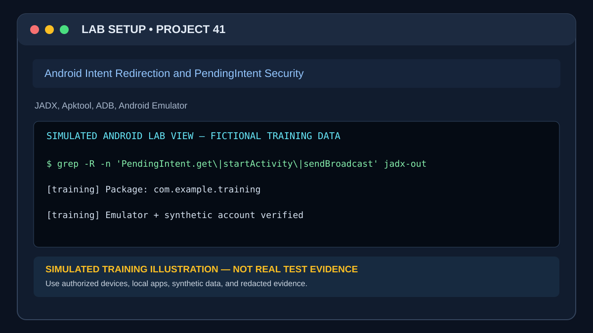
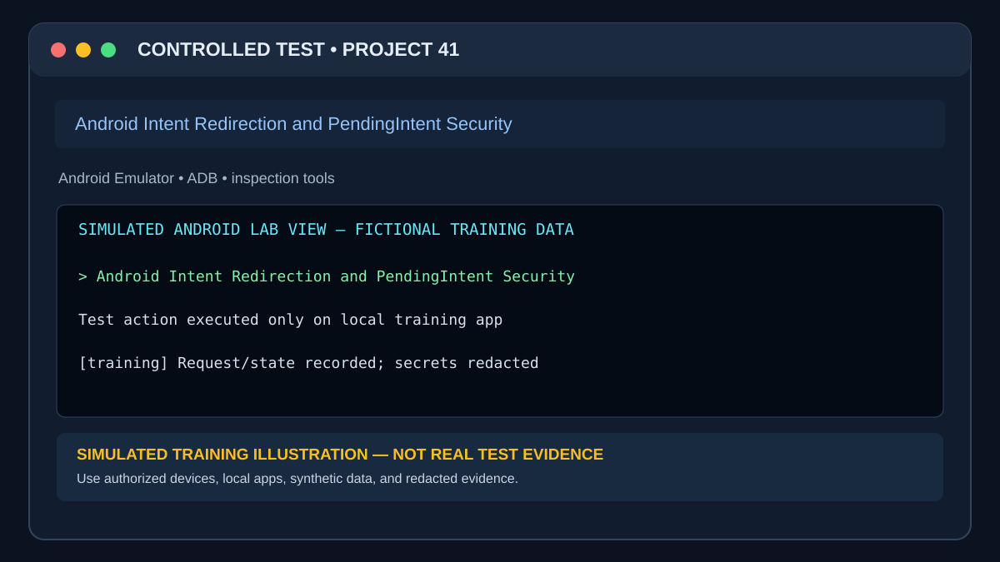
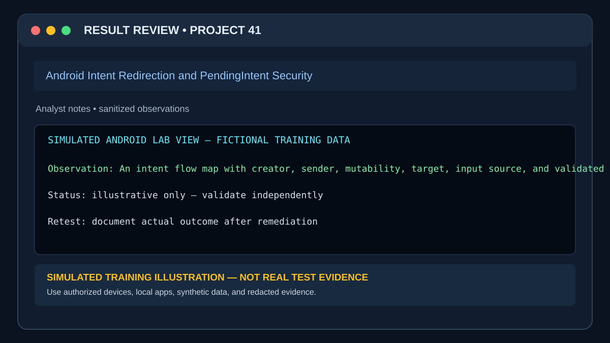

# 41. Android Intent Redirection and PendingIntent Security

<sub><b>ADVANCED</b> · Android mobile application security testing</sub>

> **SIMULATED TRAINING WALKTHROUGH — NOT REAL TEST EVIDENCE.** Images and sample observations are fictional UI illustrations. Perform tests only in an isolated lab you control or under written authorization.

## Objective

Review intent forwarding, mutable/immutable PendingIntents, explicit component targeting, and caller-controlled data.

## Lab and prerequisites

- Dedicated Android Studio Emulator or test device with disposable profile and snapshot.
- Owner-provided training APK, synthetic data, and an isolated test network.
- **Tools:** JADX, Apktool, ADB, Android Emulator.
- Confirm scope, package/build hash, device/API level, account roles, tool versions, test window, and stop conditions.
- Do not touch production accounts, real user data, or third-party applications.

## Step 1 — Baseline and target verification

Record package identity, APK SHA-256, signing/build details, device serial, Android API level, and normal app behavior. Confirm the target package before running commands.

```bash
adb devices -l
adb shell getprop ro.build.version.release
adb shell pm list packages | grep -F 'com.example.training'
```

## Step 2 — Inspect the implementation

Use the listed tools to map relevant manifest declarations, code paths, native components, or platform behavior. Record file/class/method references and identify the expected security property. Preserve an untouched APK copy and emulator snapshot.

## Step 3 — Controlled assessment procedure

1. Locate PendingIntent creation and intent redirection code paths.
2. Record mutability flags, request codes, target components, and extras.
3. Inspect whether untrusted input controls component names, URIs, or nested intents.
4. Exercise benign cases in the owner-provided training app and compare expected target resolution.
5. Verify that sensitive intents are explicit, immutable where possible, and validate all forwarded data.

Example lab command:

```bash
grep -R -n 'PendingIntent.get\|startActivity\|sendBroadcast' jadx-out
```

Adapt it to the test APK and tool version. Do not execute against unrelated devices, services, or accounts. Stop if the test affects data outside the agreed scope.

## Step 4 — Expected observations and validation

An intent flow map with creator, sender, mutability, target, input source, and validated permission behavior.

Intent redirection or mutable PendingIntents may let another app influence privileged app actions. Validate observations against source/configuration, runtime behavior, attacker prerequisites, and actual data/action impact. Distinguish confirmed behavior from theoretical paths, tool alerts, and false positives.

## Step 5 — Remediation and retest

Use explicit intents, immutable PendingIntents by default, strict input validation, and authorization at the destination.

Retest the corrected build with the same device/API level and equivalent test conditions. Record build hashes, timestamps, before/after results, residual risk, and platform-specific limitations.

## Simulated tool screenshots

> These project-specific images are fictional training illustrations, not actual tool output or evidence of a real assessment.







## Evidence and deliverables

- Authorization, scope, exclusions, and stop conditions.
- APK/build hash, package, device/API level, tool versions, and test identities.
- Reproducible commands/actions, source references, timestamps, and sanitized logs/screenshots.
- Expected versus observed behavior, validated impact, confidence, and limitations.
- Remediation owner, retest evidence, and residual risk. Keep secrets and private APKs out of Git.

## Framework references

- Android Developers — PendingIntent; OWASP MASVS-PLATFORM
- [OWASP MASVS](https://mas.owasp.org/MASVS/)
- [OWASP MASTG](https://mas.owasp.org/MASTG/)

## Completion checklist

- [ ] Written scope and authorization confirmed
- [ ] Isolated device, app, and synthetic data prepared
- [ ] Test performed safely
- [ ] Evidence sanitized and labeled
- [ ] Impact independently validated
- [ ] Remediation and retest documented
