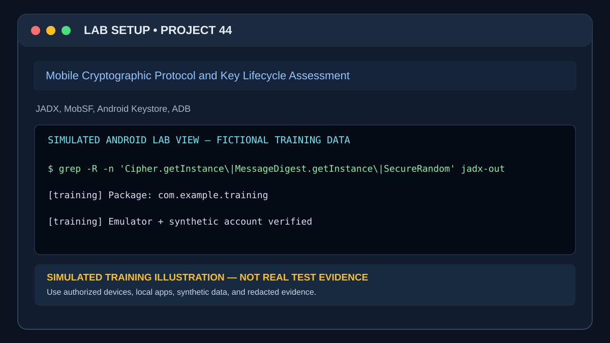
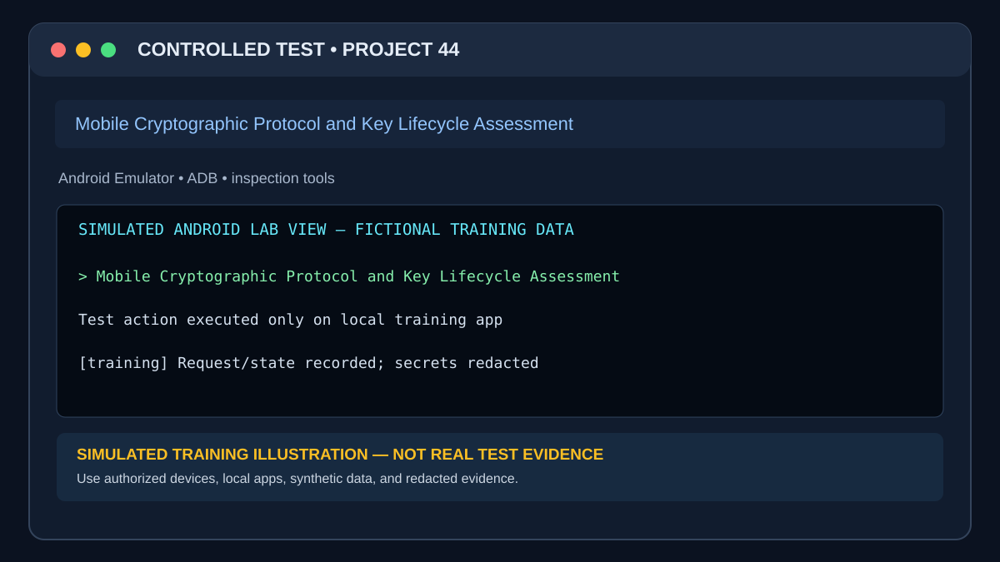
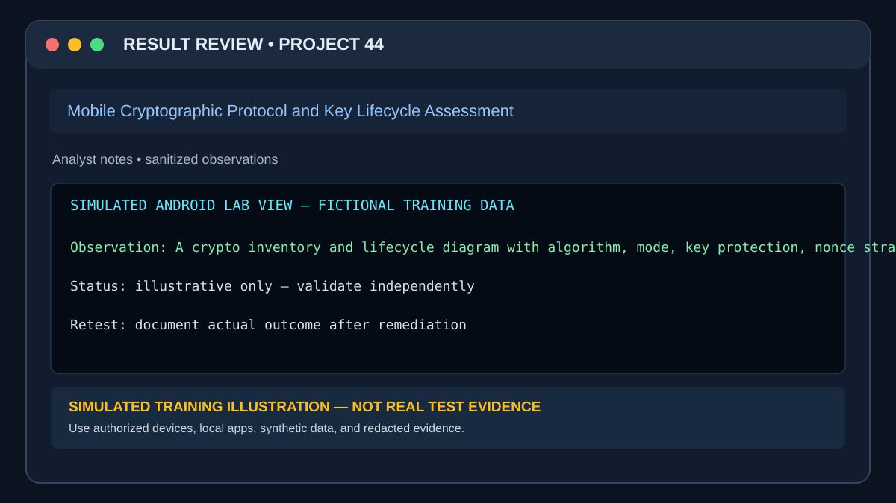

# 44. Mobile Cryptographic Protocol and Key Lifecycle Assessment

<sub><b>ADVANCED</b> · Android mobile application security testing</sub>

> **SIMULATED TRAINING WALKTHROUGH — NOT REAL TEST EVIDENCE.** Images and sample observations are fictional UI illustrations. Perform tests only in an isolated lab you control or under written authorization.

## Objective

Review cryptographic algorithm selection, key lifecycle, randomness, nonce use, and certificate validation in app-owned training code.

## Lab and prerequisites

- Dedicated Android Studio Emulator or test device with disposable profile and snapshot.
- Owner-provided training APK, synthetic data, and an isolated test network.
- **Tools:** JADX, MobSF, Android Keystore, ADB.
- Confirm scope, package/build hash, device/API level, account roles, tool versions, test window, and stop conditions.
- Do not touch production accounts, real user data, or third-party applications.

## Step 1 — Baseline and target verification

Record package identity, APK SHA-256, signing/build details, device serial, Android API level, and normal app behavior. Confirm the target package before running commands.

```bash
adb devices -l
adb shell getprop ro.build.version.release
adb shell pm list packages | grep -F 'com.example.training'
```

## Step 2 — Inspect the implementation

Use the listed tools to map relevant manifest declarations, code paths, native components, or platform behavior. Record file/class/method references and identify the expected security property. Preserve an untouched APK copy and emulator snapshot.

## Step 3 — Controlled assessment procedure

1. Inventory cryptographic APIs, algorithms, key sizes, modes, IV/nonce generation, and trust anchors.
2. Trace key generation, storage, use, rotation, invalidation, and deletion paths.
3. Check whether encryption provides authentication and whether nonces are unique as required by the mode.
4. Use synthetic plaintext and keys in the test build; do not extract real production secrets.
5. Compare implementation with current platform and OWASP guidance; record platform-specific behavior.

Example lab command:

```bash
grep -R -n 'Cipher.getInstance\|MessageDigest.getInstance\|SecureRandom' jadx-out
```

Adapt it to the test APK and tool version. Do not execute against unrelated devices, services, or accounts. Stop if the test affects data outside the agreed scope.

## Step 4 — Expected observations and validation

A crypto inventory and lifecycle diagram with algorithm, mode, key protection, nonce strategy, and validation results.

Weak primitives, nonce reuse, insecure randomness, or unmanaged keys may undermine confidentiality and integrity. Validate observations against source/configuration, runtime behavior, attacker prerequisites, and actual data/action impact. Distinguish confirmed behavior from theoretical paths, tool alerts, and false positives.

## Step 5 — Remediation and retest

Use vetted platform APIs, authenticated encryption, secure randomness, Keystore-backed keys, documented rotation, and certificate validation.

Retest the corrected build with the same device/API level and equivalent test conditions. Record build hashes, timestamps, before/after results, residual risk, and platform-specific limitations.

## Simulated tool screenshots

> These project-specific images are fictional training illustrations, not actual tool output or evidence of a real assessment.







## Evidence and deliverables

- Authorization, scope, exclusions, and stop conditions.
- APK/build hash, package, device/API level, tool versions, and test identities.
- Reproducible commands/actions, source references, timestamps, and sanitized logs/screenshots.
- Expected versus observed behavior, validated impact, confidence, and limitations.
- Remediation owner, retest evidence, and residual risk. Keep secrets and private APKs out of Git.

## Framework references

- OWASP MASVS-CRYPTO; Android Developers — Android Keystore
- [OWASP MASVS](https://mas.owasp.org/MASVS/)
- [OWASP MASTG](https://mas.owasp.org/MASTG/)

## Completion checklist

- [ ] Written scope and authorization confirmed
- [ ] Isolated device, app, and synthetic data prepared
- [ ] Test performed safely
- [ ] Evidence sanitized and labeled
- [ ] Impact independently validated
- [ ] Remediation and retest documented
