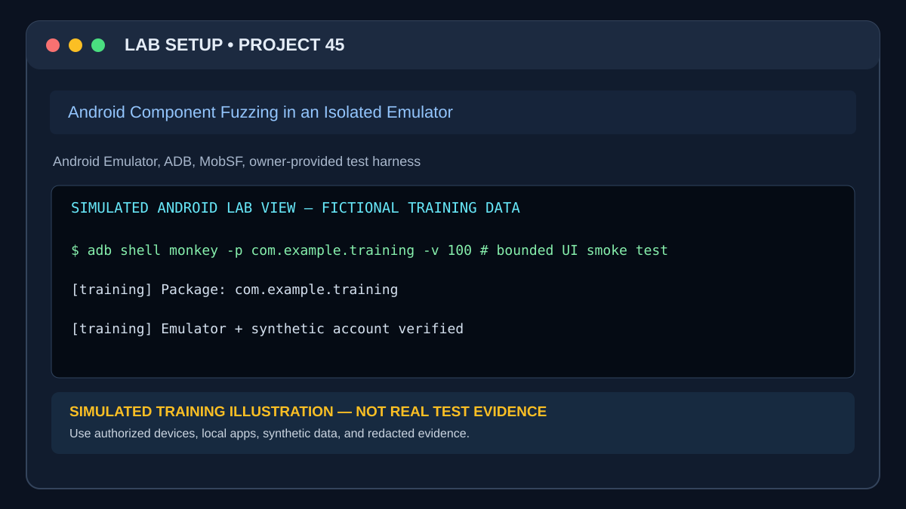
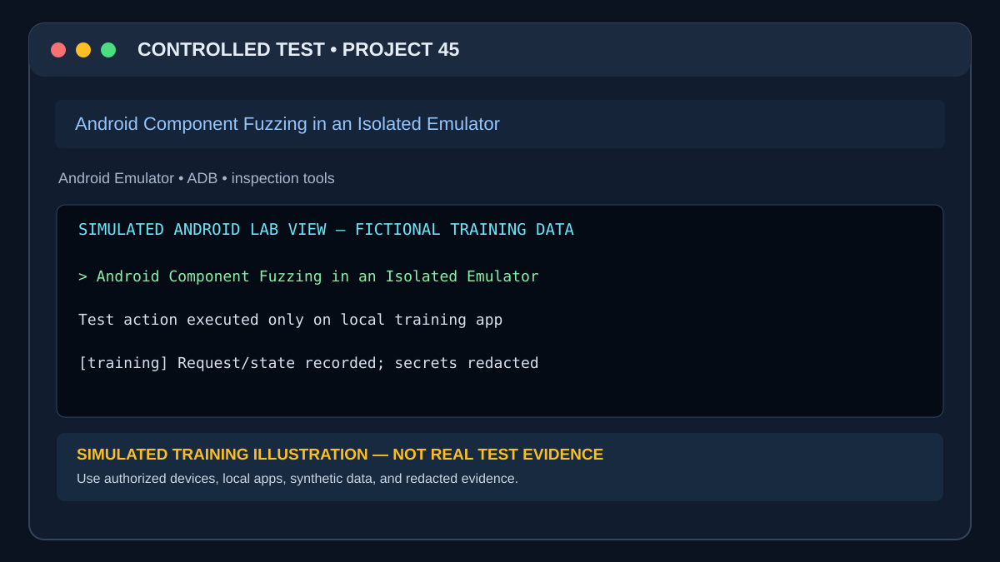
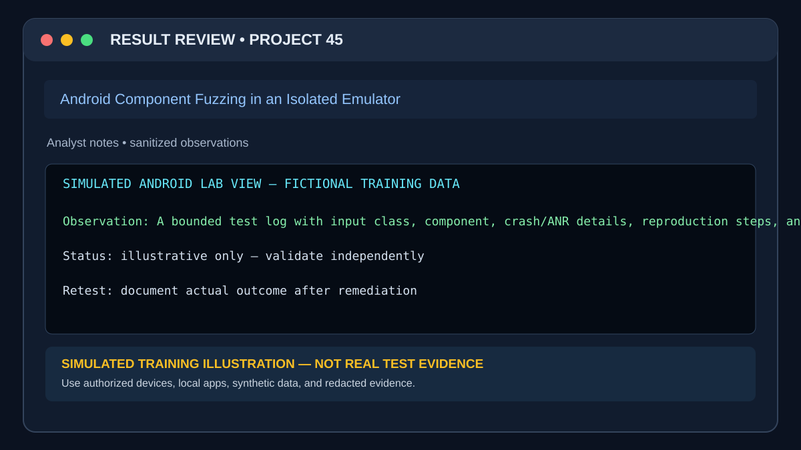

# 45. Android Component Fuzzing in an Isolated Emulator

<sub><b>ADVANCED</b> · Android mobile application security testing</sub>

> **SIMULATED TRAINING WALKTHROUGH — NOT REAL TEST EVIDENCE.** Images and sample observations are fictional UI illustrations. Perform tests only in an isolated lab you control or under written authorization.

## Objective

Perform bounded input robustness testing against owner-provided app components using synthetic values and strict resource limits.

## Lab and prerequisites

- Dedicated Android Studio Emulator or test device with disposable profile and snapshot.
- Owner-provided training APK, synthetic data, and an isolated test network.
- **Tools:** Android Emulator, ADB, MobSF, owner-provided test harness.
- Confirm scope, package/build hash, device/API level, account roles, tool versions, test window, and stop conditions.
- Do not touch production accounts, real user data, or third-party applications.

## Step 1 — Baseline and target verification

Record package identity, APK SHA-256, signing/build details, device serial, Android API level, and normal app behavior. Confirm the target package before running commands.

```bash
adb devices -l
adb shell getprop ro.build.version.release
adb shell pm list packages | grep -F 'com.example.training'
```

## Step 2 — Inspect the implementation

Use the listed tools to map relevant manifest declarations, code paths, native components, or platform behavior. Record file/class/method references and identify the expected security property. Preserve an untouched APK copy and emulator snapshot.

## Step 3 — Controlled assessment procedure

1. Define the exact package/components, test duration, event cap, and stop conditions.
2. Snapshot the emulator and confirm no production accounts or data are present.
3. Run a small bounded smoke/fuzz sequence using the owner's test harness and synthetic inputs.
4. Monitor app crashes, ANRs, logs, and resource use; stop if the emulator becomes unstable.
5. Reproduce each issue with a minimal input and distinguish expected validation failures from security impact.

Example lab command:

```bash
adb shell monkey -p com.example.training -v 100  # bounded UI smoke test
```

Adapt it to the test APK and tool version. Do not execute against unrelated devices, services, or accounts. Stop if the test affects data outside the agreed scope.

## Step 4 — Expected observations and validation

A bounded test log with input class, component, crash/ANR details, reproduction steps, and triage status.

Unhandled malformed input can cause crashes, denial of service, or unsafe state transitions. Validate observations against source/configuration, runtime behavior, attacker prerequisites, and actual data/action impact. Distinguish confirmed behavior from theoretical paths, tool alerts, and false positives.

## Step 5 — Remediation and retest

Validate input at trust boundaries, handle parser errors safely, enforce resource limits, and add regression tests for reproduced cases.

Retest the corrected build with the same device/API level and equivalent test conditions. Record build hashes, timestamps, before/after results, residual risk, and platform-specific limitations.

## Simulated tool screenshots

> These project-specific images are fictional training illustrations, not actual tool output or evidence of a real assessment.







## Evidence and deliverables

- Authorization, scope, exclusions, and stop conditions.
- APK/build hash, package, device/API level, tool versions, and test identities.
- Reproducible commands/actions, source references, timestamps, and sanitized logs/screenshots.
- Expected versus observed behavior, validated impact, confidence, and limitations.
- Remediation owner, retest evidence, and residual risk. Keep secrets and private APKs out of Git.

## Framework references

- OWASP MASTG — Fuzzing; Android Developers — Testing
- [OWASP MASVS](https://mas.owasp.org/MASVS/)
- [OWASP MASTG](https://mas.owasp.org/MASTG/)

## Completion checklist

- [ ] Written scope and authorization confirmed
- [ ] Isolated device, app, and synthetic data prepared
- [ ] Test performed safely
- [ ] Evidence sanitized and labeled
- [ ] Impact independently validated
- [ ] Remediation and retest documented
