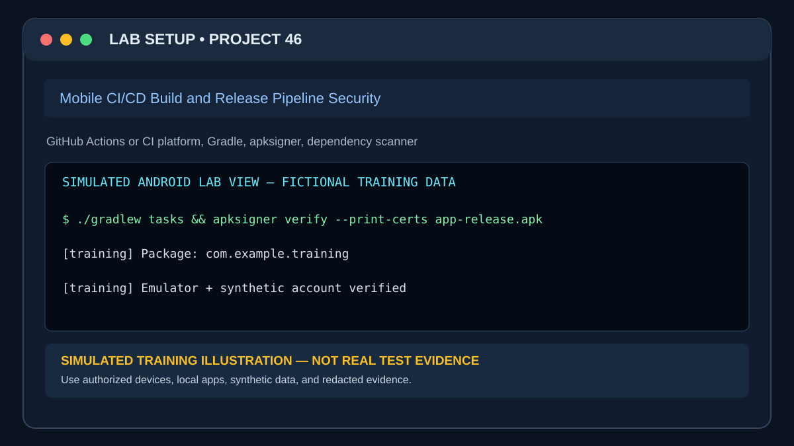
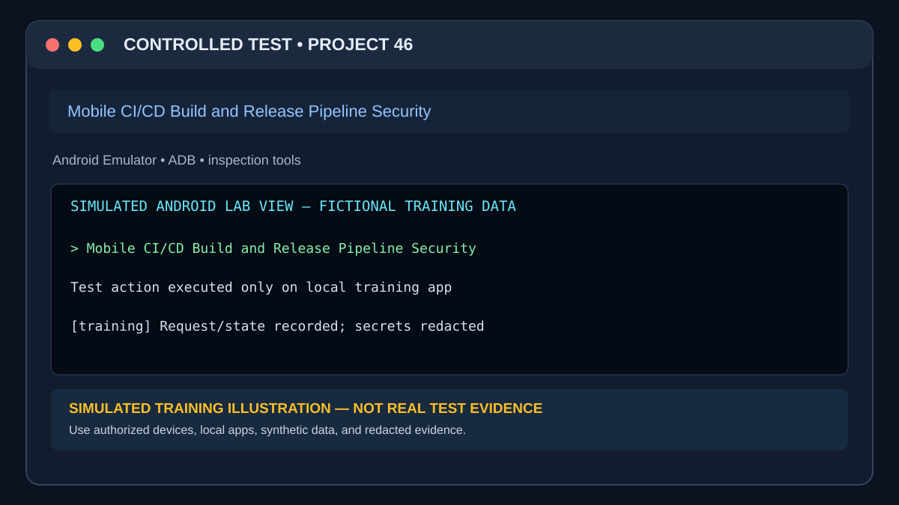
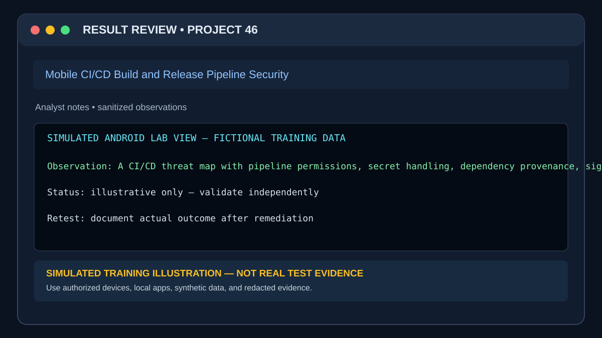

# 46. Mobile CI/CD Build and Release Pipeline Security

<sub><b>ADVANCED</b> · Android mobile application security testing</sub>

> **SIMULATED TRAINING WALKTHROUGH — NOT REAL TEST EVIDENCE.** Images and sample observations are fictional UI illustrations. Perform tests only in an isolated lab you control or under written authorization.

## Objective

Assess the security of mobile build workflows, signing-key custody, dependency provenance, artifact storage, and release approvals.

## Lab and prerequisites

- Owner-provided training APK, synthetic data, and isolated Android test device/emulator.
- **Tools:** GitHub Actions or CI platform, Gradle, apksigner, dependency scanner.
- Confirm scope, package/build hash, device/API level, accounts, tool versions, test window, and stop conditions.
- Preserve a baseline APK and emulator snapshot. Keep secrets and private build artifacts out of Git.

## Step 1 — Baseline and target verification

Record package identity, APK SHA-256, signing/build details, device serial, Android API level, tool versions, and normal behavior. Confirm the package and target before executing tests.

```bash
adb devices -l
adb shell getprop ro.build.version.release
adb shell pm list packages | grep -F 'com.example.training'
```

## Step 2 — Map the system

Identify the app components, backend services, build artifacts, dependencies, data flows, and trust boundaries relevant to this project. Document the expected security property and the evidence needed to validate it.

## Step 3 — Controlled assessment procedure

1. Map source control, build triggers, runners, secrets, dependencies, signing, and artifact publication.
2. Review workflow permissions, branch protections, untrusted pull-request handling, and secret exposure.
3. Inspect dependency lockfiles and software bill of materials for known vulnerable components.
4. Verify signing keys are isolated from general build jobs and release artifacts are traceable to reviewed commits.
5. Use a sample pipeline and dummy signing material to test approval and artifact integrity controls.

Example starting point:

```bash
./gradlew tasks && apksigner verify --print-certs app-release.apk
```

Adapt the example to your own lab and tool version. Do not execute against unrelated devices, services, or accounts. Stop if the test affects data outside the agreed scope.

## Step 4 — Expected observations and validation

A CI/CD threat map with pipeline permissions, secret handling, dependency provenance, signing controls, and artifact verification.

Compromised build workflows or signing secrets can distribute malicious mobile releases to users. Validate observations against source/configuration, runtime behavior, attacker prerequisites, and actual data/action impact. Distinguish confirmed findings from theoretical paths, tool alerts, and false positives.

## Step 5 — Remediation and retest

Apply least-privilege pipeline tokens, protected environments, isolated signing, dependency pinning/scanning, provenance attestations, and audited releases.

Retest the corrected build or pipeline with equivalent conditions. Record versions, hashes, timestamps, before/after results, residual risk, and platform-specific limitations.

## Simulated tool screenshots

> These project-specific images are fictional training illustrations, not actual tool output or evidence of a real assessment.







## Evidence and deliverables

- Authorization, scope, exclusions, and stop conditions.
- APK/build hash, package, device/API level, tool versions, and test identities.
- Reproducible commands/actions, source references, timestamps, and sanitized logs/screenshots.
- Expected versus observed behavior, validated impact, confidence, and limitations.
- Remediation owner, retest evidence, and residual risk. Keep secrets and private APKs out of Git.

## Framework references

- OWASP MASVS-RESILIENCE; SLSA Framework; GitHub Actions security hardening
- [OWASP MASVS](https://mas.owasp.org/MASVS/)
- [OWASP MASTG](https://mas.owasp.org/MASTG/)

## Completion checklist

- [ ] Written scope and authorization confirmed
- [ ] Isolated device/app/build and synthetic data prepared
- [ ] Test performed safely
- [ ] Evidence sanitized and labeled
- [ ] Impact independently validated
- [ ] Remediation and retest documented
