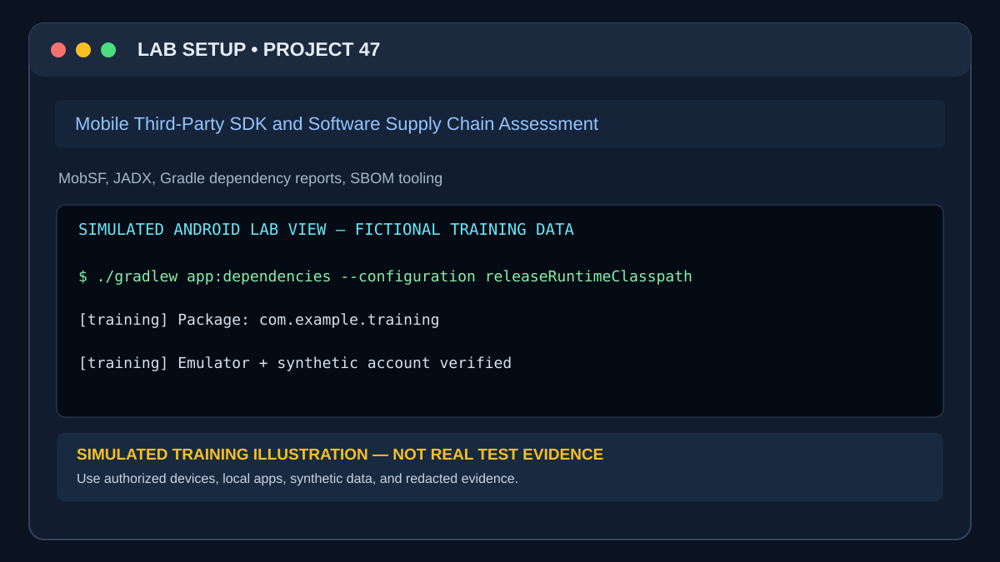
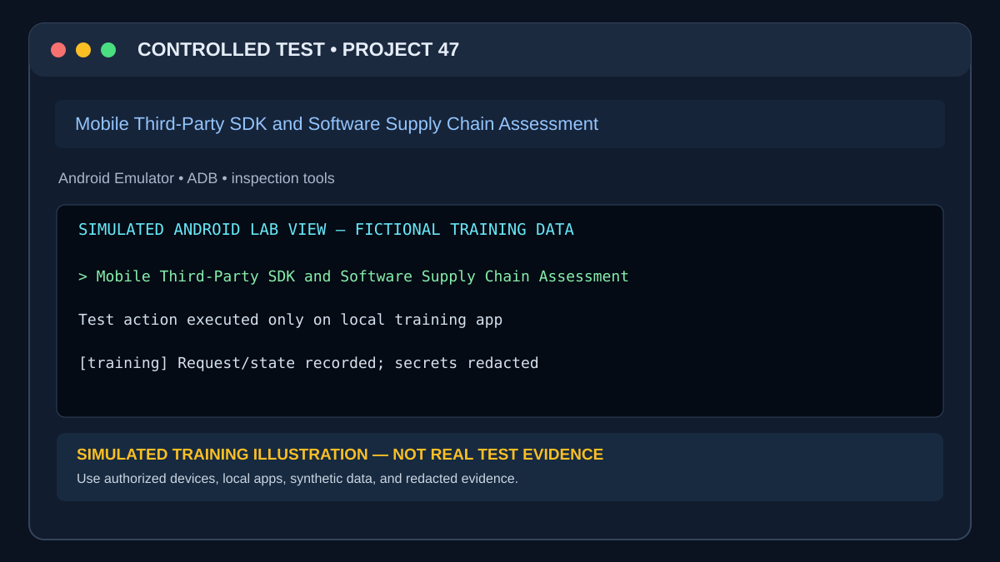
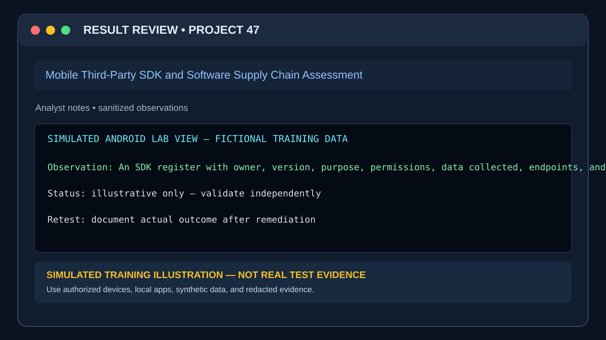

# 47. Mobile Third-Party SDK and Software Supply Chain Assessment

<sub><b>ADVANCED</b> · Android mobile application security testing</sub>

> **SIMULATED TRAINING WALKTHROUGH — NOT REAL TEST EVIDENCE.** Images and sample observations are fictional UI illustrations. Perform tests only in an isolated lab you control or under written authorization.

## Objective

Inventory third-party SDKs and assess permissions, data collection, network destinations, update practices, and dependency risk.

## Lab and prerequisites

- Owner-provided training APK, synthetic data, and isolated Android test device/emulator.
- **Tools:** MobSF, JADX, Gradle dependency reports, SBOM tooling.
- Confirm scope, package/build hash, device/API level, accounts, tool versions, test window, and stop conditions.
- Preserve a baseline APK and emulator snapshot. Keep secrets and private build artifacts out of Git.

## Step 1 — Baseline and target verification

Record package identity, APK SHA-256, signing/build details, device serial, Android API level, tool versions, and normal behavior. Confirm the package and target before executing tests.

```bash
adb devices -l
adb shell getprop ro.build.version.release
adb shell pm list packages | grep -F 'com.example.training'
```

## Step 2 — Map the system

Identify the app components, backend services, build artifacts, dependencies, data flows, and trust boundaries relevant to this project. Document the expected security property and the evidence needed to validate it.

## Step 3 — Controlled assessment procedure

1. Generate a release dependency inventory and record direct/transitive versions.
2. Identify analytics, advertising, crash, identity, payment, and networking SDKs.
3. Review SDK permissions, initialization, data fields, destinations, and opt-out behavior.
4. Check known vulnerabilities, unsupported versions, provenance, and license obligations.
5. Use synthetic app activity and inspect traffic only in the authorized test build.

Example starting point:

```bash
./gradlew app:dependencies --configuration releaseRuntimeClasspath
```

Adapt the example to your own lab and tool version. Do not execute against unrelated devices, services, or accounts. Stop if the test affects data outside the agreed scope.

## Step 4 — Expected observations and validation

An SDK register with owner, version, purpose, permissions, data collected, endpoints, and remediation status.

A vulnerable or over-privileged SDK can introduce privacy, data leakage, or code execution risks into the app. Validate observations against source/configuration, runtime behavior, attacker prerequisites, and actual data/action impact. Distinguish confirmed findings from theoretical paths, tool alerts, and false positives.

## Step 5 — Remediation and retest

Minimize SDKs, pin supported versions, review vendor security practices, restrict data/permissions, and monitor dependency advisories.

Retest the corrected build or pipeline with equivalent conditions. Record versions, hashes, timestamps, before/after results, residual risk, and platform-specific limitations.

## Simulated tool screenshots

> These project-specific images are fictional training illustrations, not actual tool output or evidence of a real assessment.







## Evidence and deliverables

- Authorization, scope, exclusions, and stop conditions.
- APK/build hash, package, device/API level, tool versions, and test identities.
- Reproducible commands/actions, source references, timestamps, and sanitized logs/screenshots.
- Expected versus observed behavior, validated impact, confidence, and limitations.
- Remediation owner, retest evidence, and residual risk. Keep secrets and private APKs out of Git.

## Framework references

- OWASP MASVS-CODE; OWASP Mobile Top 10; CycloneDX SBOM
- [OWASP MASVS](https://mas.owasp.org/MASVS/)
- [OWASP MASTG](https://mas.owasp.org/MASTG/)

## Completion checklist

- [ ] Written scope and authorization confirmed
- [ ] Isolated device/app/build and synthetic data prepared
- [ ] Test performed safely
- [ ] Evidence sanitized and labeled
- [ ] Impact independently validated
- [ ] Remediation and retest documented
