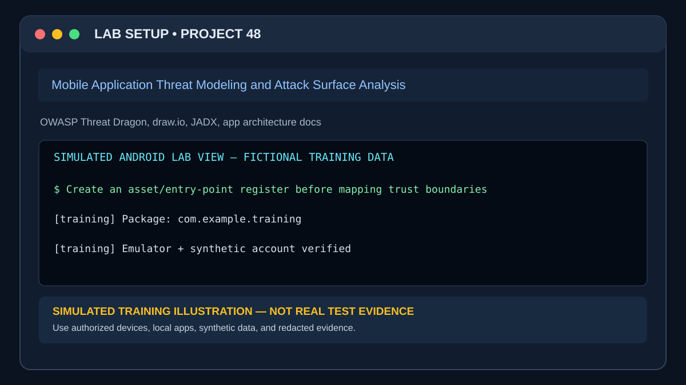
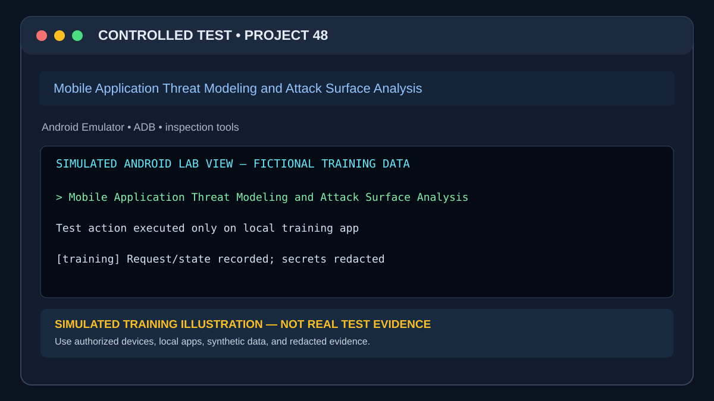
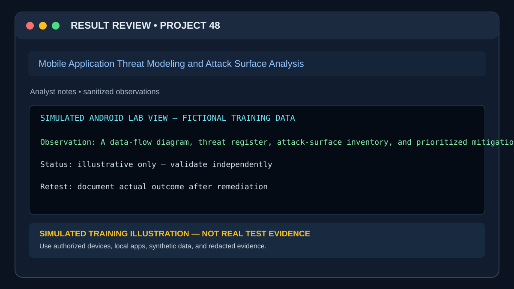

# 48. Mobile Application Threat Modeling and Attack Surface Analysis

<sub><b>ADVANCED</b> · Android mobile application security testing</sub>

> **SIMULATED TRAINING WALKTHROUGH — NOT REAL TEST EVIDENCE.** Images and sample observations are fictional UI illustrations. Perform tests only in an isolated lab you control or under written authorization.

## Objective

Build a threat model for the mobile app covering assets, entry points, trust boundaries, abuse cases, and security controls.

## Lab and prerequisites

- Owner-provided training APK, synthetic data, and isolated Android test device/emulator.
- **Tools:** OWASP Threat Dragon, draw.io, JADX, app architecture docs.
- Confirm scope, package/build hash, device/API level, accounts, tool versions, test window, and stop conditions.
- Preserve a baseline APK and emulator snapshot. Keep secrets and private build artifacts out of Git.

## Step 1 — Baseline and target verification

Record package identity, APK SHA-256, signing/build details, device serial, Android API level, tool versions, and normal behavior. Confirm the package and target before executing tests.

```bash
adb devices -l
adb shell getprop ro.build.version.release
adb shell pm list packages | grep -F 'com.example.training'
```

## Step 2 — Map the system

Identify the app components, backend services, build artifacts, dependencies, data flows, and trust boundaries relevant to this project. Document the expected security property and the evidence needed to validate it.

## Step 3 — Controlled assessment procedure

1. Identify sensitive assets, user roles, data flows, backend services, and third-party dependencies.
2. Map entry points including exported components, deep links, WebViews, APIs, local storage, and IPC.
3. Draw trust boundaries between device, app process, OS, backend, and external SDKs.
4. Enumerate abuse cases and map existing controls to MASVS requirements.
5. Prioritize mitigations by exploitability, business impact, and feasibility; assign owners.

Example starting point:

```bash
Create an asset/entry-point register before mapping trust boundaries
```

Adapt the example to your own lab and tool version. Do not execute against unrelated devices, services, or accounts. Stop if the test affects data outside the agreed scope.

## Step 4 — Expected observations and validation

A data-flow diagram, threat register, attack-surface inventory, and prioritized mitigation plan.

Unmodeled trust boundaries can leave critical attack paths and privacy risks outside routine testing. Validate observations against source/configuration, runtime behavior, attacker prerequisites, and actual data/action impact. Distinguish confirmed findings from theoretical paths, tool alerts, and false positives.

## Step 5 — Remediation and retest

Maintain threat models with architecture changes, security requirements, abuse-case tests, and control ownership.

Retest the corrected build or pipeline with equivalent conditions. Record versions, hashes, timestamps, before/after results, residual risk, and platform-specific limitations.

## Simulated tool screenshots

> These project-specific images are fictional training illustrations, not actual tool output or evidence of a real assessment.







## Evidence and deliverables

- Authorization, scope, exclusions, and stop conditions.
- APK/build hash, package, device/API level, tool versions, and test identities.
- Reproducible commands/actions, source references, timestamps, and sanitized logs/screenshots.
- Expected versus observed behavior, validated impact, confidence, and limitations.
- Remediation owner, retest evidence, and residual risk. Keep secrets and private APKs out of Git.

## Framework references

- OWASP Threat Dragon; OWASP MASVS; NIST SP 800-154
- [OWASP MASVS](https://mas.owasp.org/MASVS/)
- [OWASP MASTG](https://mas.owasp.org/MASTG/)

## Completion checklist

- [ ] Written scope and authorization confirmed
- [ ] Isolated device/app/build and synthetic data prepared
- [ ] Test performed safely
- [ ] Evidence sanitized and labeled
- [ ] Impact independently validated
- [ ] Remediation and retest documented
