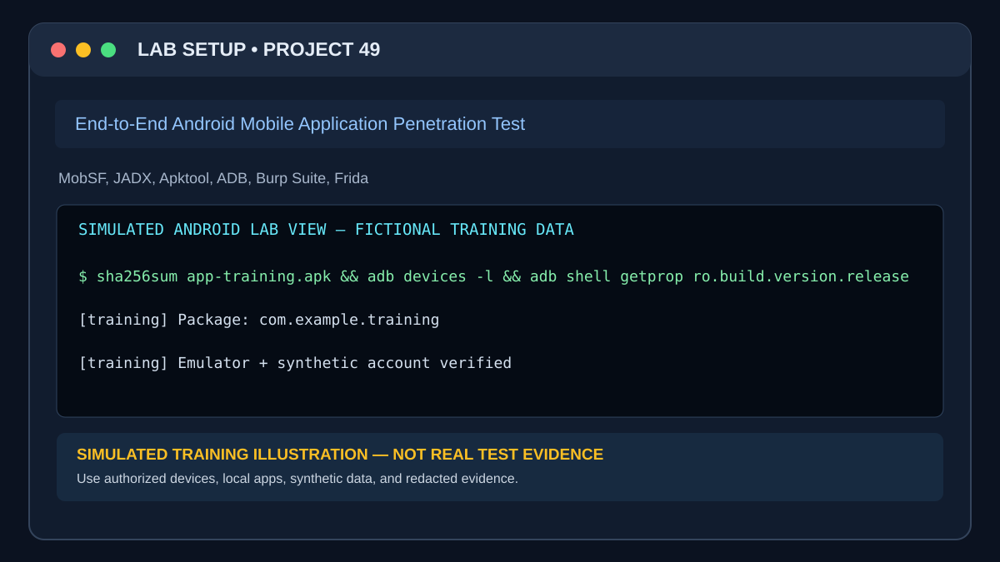
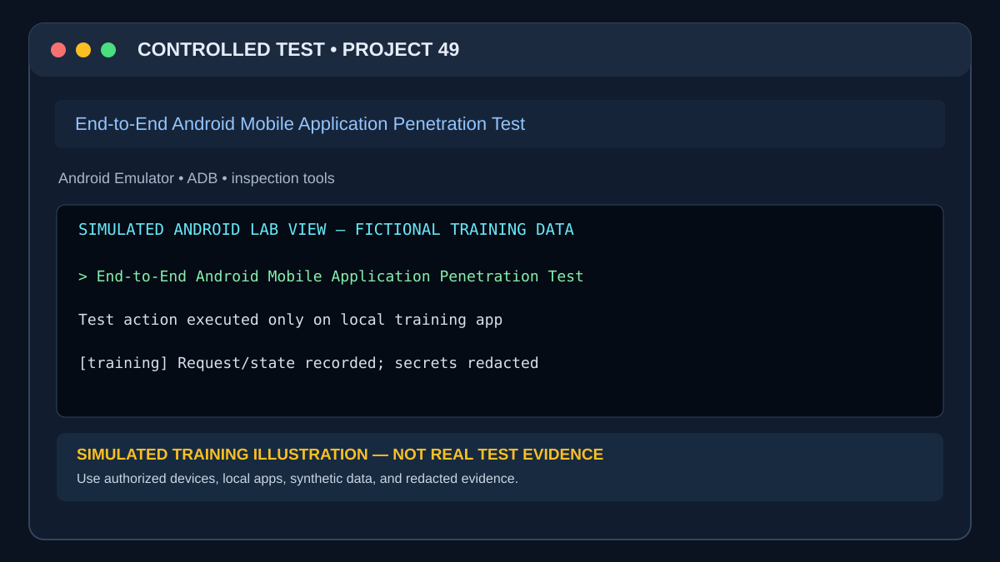
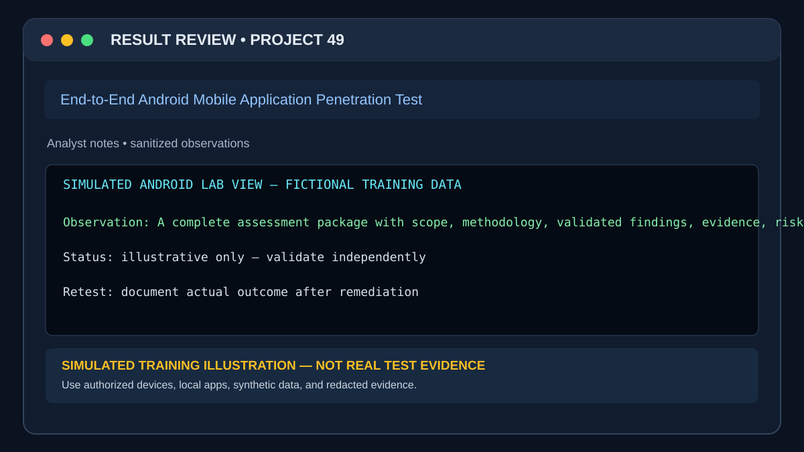

# 49. End-to-End Android Mobile Application Penetration Test

<sub><b>ADVANCED</b> · Android mobile application security testing</sub>

> **SIMULATED TRAINING WALKTHROUGH — NOT REAL TEST EVIDENCE.** Images and sample observations are fictional UI illustrations. Perform tests only in an isolated lab you control or under written authorization.

## Objective

Combine static, dynamic, network, platform, storage, and API assessments into a scoped end-to-end mobile security engagement.

## Lab and prerequisites

- Owner-provided training APK, synthetic data, and isolated Android test device/emulator.
- **Tools:** MobSF, JADX, Apktool, ADB, Burp Suite, Frida.
- Confirm scope, package/build hash, device/API level, accounts, tool versions, test window, and stop conditions.
- Preserve a baseline APK and emulator snapshot. Keep secrets and private build artifacts out of Git.

## Step 1 — Baseline and target verification

Record package identity, APK SHA-256, signing/build details, device serial, Android API level, tool versions, and normal behavior. Confirm the package and target before executing tests.

```bash
adb devices -l
adb shell getprop ro.build.version.release
adb shell pm list packages | grep -F 'com.example.training'
```

## Step 2 — Map the system

Identify the app components, backend services, build artifacts, dependencies, data flows, and trust boundaries relevant to this project. Document the expected security property and the evidence needed to validate it.

## Step 3 — Controlled assessment procedure

1. Confirm written authorization, package/build hash, supported Android versions, accounts, backend scope, and stop conditions.
2. Perform static review of manifest, permissions, components, storage, crypto, network configuration, and dependencies.
3. Perform dynamic review of runtime behavior, local storage, IPC, WebViews, authentication, and network traffic.
4. Assess backend API authorization using synthetic users and records; validate all findings independently.
5. Retest fixes and produce an executive summary, technical findings, evidence, and residual-risk register.

Example starting point:

```bash
sha256sum app-training.apk && adb devices -l && adb shell getprop ro.build.version.release
```

Adapt the example to your own lab and tool version. Do not execute against unrelated devices, services, or accounts. Stop if the test affects data outside the agreed scope.

## Step 4 — Expected observations and validation

A complete assessment package with scope, methodology, validated findings, evidence, risk ranking, remediation, and retest.

Gaps across app, device, and backend boundaries can combine into attack chains with material business impact. Validate observations against source/configuration, runtime behavior, attacker prerequisites, and actual data/action impact. Distinguish confirmed findings from theoretical paths, tool alerts, and false positives.

## Step 5 — Remediation and retest

Prioritize server-side authorization, secure storage/transport, platform hardening, dependency hygiene, and repeatable release testing.

Retest the corrected build or pipeline with equivalent conditions. Record versions, hashes, timestamps, before/after results, residual risk, and platform-specific limitations.

## Simulated tool screenshots

> These project-specific images are fictional training illustrations, not actual tool output or evidence of a real assessment.







## Evidence and deliverables

- Authorization, scope, exclusions, and stop conditions.
- APK/build hash, package, device/API level, tool versions, and test identities.
- Reproducible commands/actions, source references, timestamps, and sanitized logs/screenshots.
- Expected versus observed behavior, validated impact, confidence, and limitations.
- Remediation owner, retest evidence, and residual risk. Keep secrets and private APKs out of Git.

## Framework references

- OWASP MASTG; OWASP MASVS; OWASP Mobile Top 10
- [OWASP MASVS](https://mas.owasp.org/MASVS/)
- [OWASP MASTG](https://mas.owasp.org/MASTG/)

## Completion checklist

- [ ] Written scope and authorization confirmed
- [ ] Isolated device/app/build and synthetic data prepared
- [ ] Test performed safely
- [ ] Evidence sanitized and labeled
- [ ] Impact independently validated
- [ ] Remediation and retest documented
