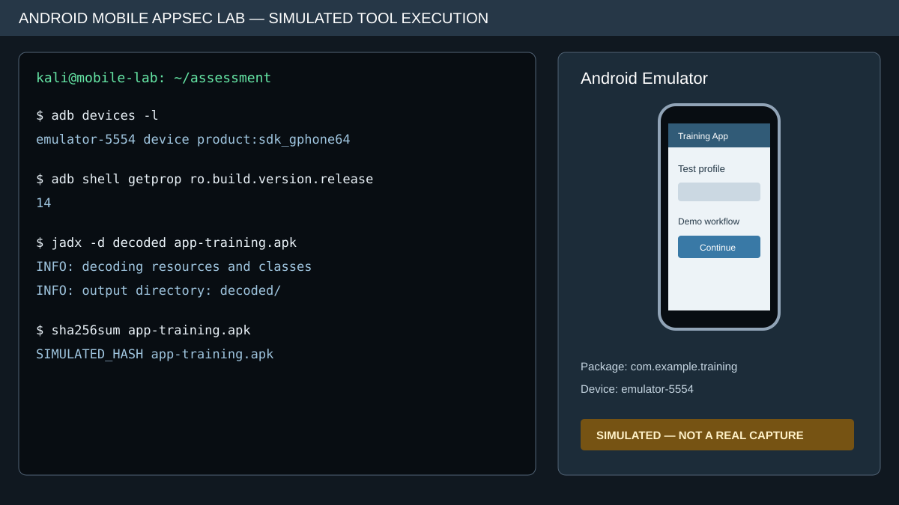
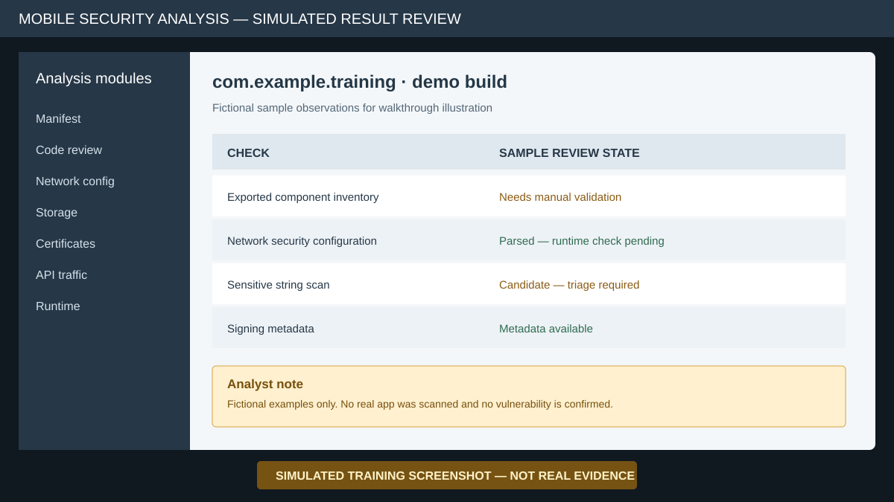

# 14. Application Signature and Certificate Review

<sub><b>BEGINNER</b> · Android mobile application security testing</sub>

> **SIMULATED TRAINING WALKTHROUGH — NOT REAL TEST EVIDENCE.** The screenshots and sample observations in this repository are illustrative UI simulations. No tool was run and no vulnerability is asserted. Perform these steps only against your own lab app/device or a target covered by written authorization.

## Objective

A signing verification record; a self-signed development certificate is not automatically a vulnerability.

## Lab and prerequisites

- Android Studio Emulator or a dedicated test device with a disposable test profile.
- An intentionally vulnerable training APK and synthetic test data.
- **Tools:** ApkSigner, apksigner.
- Confirm package name, APK version/hash, device serial, Android API level, test accounts, and allowed test window before starting.

## Step 1 — Prepare and identify the target

Connect the lab device and verify the package/build. Keep a notes file containing the authorization reference, target package, device, app version, date, and tool versions. Do not use personal or production accounts.

```bash
adb devices -l
adb shell getprop ro.build.version.release
adb shell pm list packages | grep -F 'com.example.training'
```

## Step 2 — Perform the project test

The following commands are a starting point for the controlled lab. Replace placeholders with values from your own emulator and test APK; do not point them at an unrelated device or service.

```bash
apksigner verify --verbose --print-certs app.apk
```

### Simulated tool view — test execution



*Illustrative mobile assessment workstation showing a Kali terminal and Android analysis workflow. It is a simulation, not a captured tool session.*

## Step 3 — Validate the observation

Verify APK signing status, signer certificate digest, and signature scheme support. Compare the certificate with the expected publisher/build identity supplied for the lab.

Compare the observation with the expected secure behavior for the Android versions and app build in scope. A static alert, manifest attribute, or single log line is a lead—not a confirmed vulnerability. Validate reachability, attacker prerequisites, data sensitivity, and actual impact.

## Step 4 — Review and interpret results

Expected training outcome: A signing verification record; a self-signed development certificate is not automatically a vulnerability. Record both positive controls and weaknesses. Mark each item **confirmed**, **not observed**, **false positive**, or **needs further validation**. Never invent a finding to match an example screenshot.

### Simulated tool view — result review



*Illustrative result triage screen with fictional package/build values and sample analyst notes. Not actual MobSF/JADX/ADB/Burp output.*

## Step 5 — Evidence and report

Save sanitized evidence under this project's `evidence/` directory:

- Target package, app version, APK SHA-256, device/API level, and tool versions.
- Exact commands/actions and timestamps.
- Relevant redacted output, screenshots, and request/response pairs where applicable.
- Expected versus observed behavior and reproducible validation steps.
- Limitations, false positives, and anything not tested.

Use [the report template](../../REPORT_TEMPLATE.md). Never commit passwords, API tokens, session cookies, private keys, personal data, or proprietary APKs unless you have explicit permission to publish them.

## Remediation guidance

Apply least privilege, server-side authorization, secure platform APIs, appropriate Android Network Security Config, safe data storage, and release-build hardening as applicable. Verify fixes with a repeatable retest on the same supported Android versions.

## Completion checklist

- [ ] Scope and authorization recorded
- [ ] Lab package/build and device identified
- [ ] Test steps completed in an isolated lab
- [ ] Evidence sanitized and clearly labeled
- [ ] Findings validated and severity justified
- [ ] Remediation and retest criteria documented
