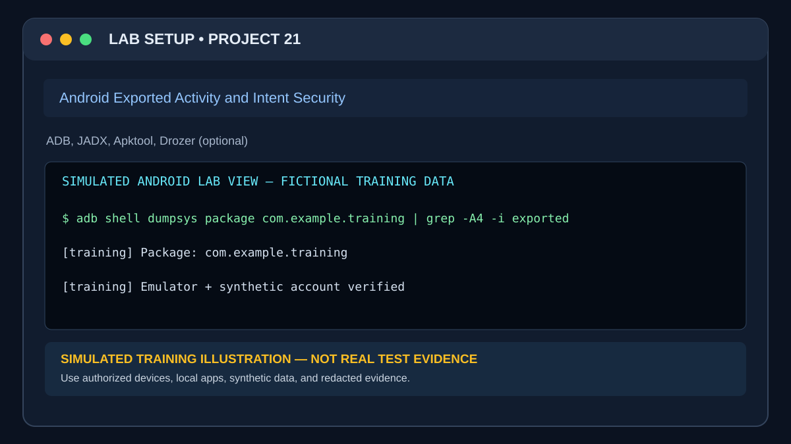
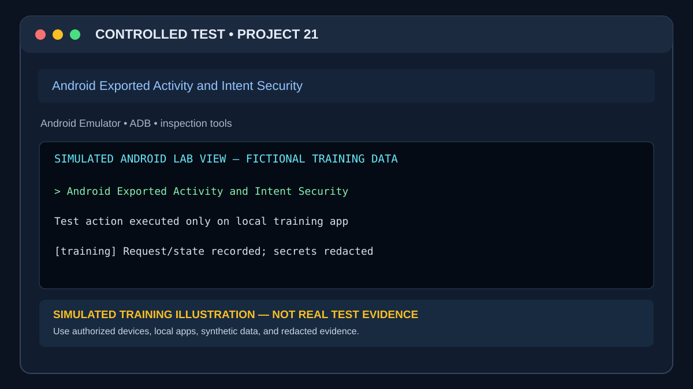
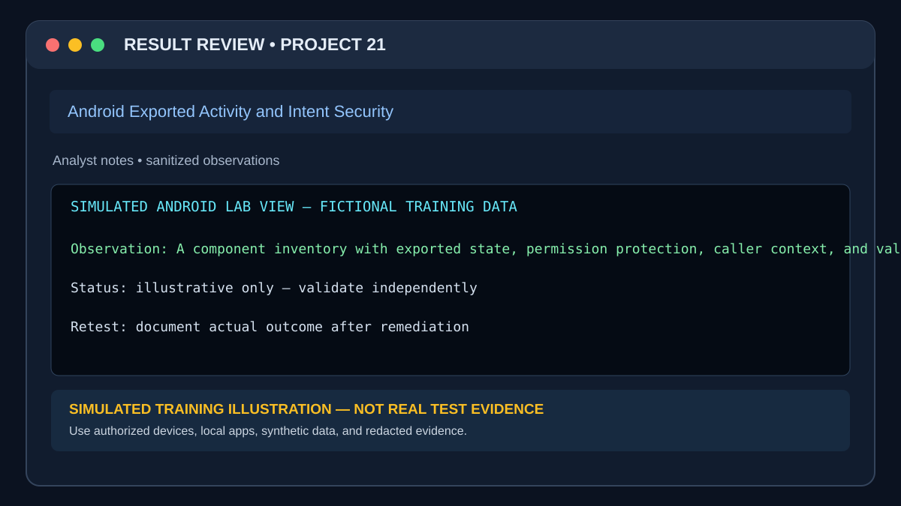

# 21. Android Exported Activity and Intent Security

<sub><b>INTERMEDIATE</b> · Android mobile application security testing</sub>

> **SIMULATED TRAINING WALKTHROUGH — NOT REAL TEST EVIDENCE.** Screenshots and sample observations are fictional UI illustrations. Run tests only against your own lab app/device or a target covered by written authorization.

## Objective

Inventory exported activities, services, and receivers, then verify whether sensitive components enforce caller permissions and server-side authorization.

## Lab and prerequisites

- Android Studio Emulator or dedicated test device with a disposable test profile.
- An intentionally vulnerable training APK and synthetic test data.
- **Tools:** ADB, JADX, Apktool, Drozer (optional).
- Confirm authorization, package name, APK version/hash, device serial, Android API level, test accounts, and allowed test window.
- Keep the emulator on a host-only or otherwise isolated test network. Snapshot before runtime changes.

## Step 1 — Prepare the target

Install the training APK and verify its identity. Record package/build, device/API level, tool versions, and baseline behavior. Use synthetic accounts and data; do not connect personal or production accounts.

```bash
adb devices -l
adb shell getprop ro.build.version.release
adb shell pm list packages | grep -F 'com.example.training'
```

## Step 2 — Inspect the implementation

Use JADX/Apktool or the relevant platform tool to identify the manifest, components, configuration, and code paths associated with the feature. Record file/class/method names and the expected security control. Do not modify or republish third-party APKs.

## Step 3 — Perform the controlled test

1. Extract the APK manifest with Apktool and list exported components, intent filters, and declared permissions.
2. Correlate each component with its implementation in JADX; identify sensitive actions and data flows.
3. In the emulator, invoke only the app's own test components with benign inputs and a disposable account.
4. Compare access as the authorized app user and an unprivileged lab test app; record denied and allowed cases.
5. Validate whether sensitive operations enforce authorization inside the component, not only in the UI.

Example starting point (adapt to the local app and tool version):

```bash
adb shell dumpsys package com.example.training | grep -A4 -i exported
```

The command is a lab example. Confirm the exact target and package before execution; do not run it against an unrelated device or service.

## Step 4 — Validate and interpret

Expected training output: A component inventory with exported state, permission protection, caller context, and validated access-control observations.

An exported component without suitable protection may expose privileged app functions or data to another installed app. A manifest flag, static-analysis alert, or isolated log entry is a lead—not a confirmed vulnerability. Validate attacker prerequisites, reachability, affected data/action, actual impact, and relevant positive controls. Record **confirmed**, **not observed**, **false positive**, or **needs further validation**.

## Step 5 — Remediation and retest

Set android:exported explicitly, require signature-level permissions for sensitive IPC, validate callers and inputs, and enforce authorization in the component.

Repeat the same test on the corrected build and supported Android versions. Record before/after behavior, build hash, timestamp, and residual limitations. Do not close a finding solely because a configuration value changed; verify the security property.

## Simulated tool screenshots

> These project-specific images are fictional training illustrations, not genuine ADB/JADX/Burp/Frida output or evidence of a real assessment.







## Evidence and deliverables

- Authorization and scope record; package, build hash, device/API level, and tool versions.
- Reproducible commands/actions and timestamps.
- Sanitized logs, screenshots, relevant source/configuration references, and test account roles.
- Expected versus observed behavior, validated impact, limitations, and remediation owner.
- Retest outcome and residual risk. Never commit credentials, tokens, private keys, personal data, or proprietary APKs without permission.

## Framework references

- Android Developers — Intents and Intent Filters; OWASP MASVS-PLATFORM
- [OWASP Mobile Application Security Verification Standard (MASVS)](https://mas.owasp.org/MASVS/)
- [OWASP Mobile Application Security Testing Guide (MASTG)](https://mas.owasp.org/MASTG/)

## Completion checklist

- [ ] Scope and authorization recorded
- [ ] Lab package/build and device identified
- [ ] Static and/or dynamic test completed safely
- [ ] Evidence sanitized and labeled as real or simulated
- [ ] Finding validated and severity justified
- [ ] Remediation and repeatable retest documented
