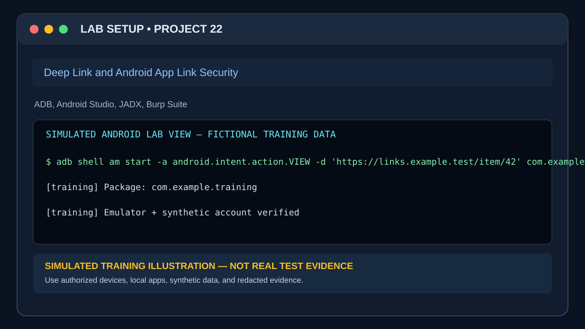
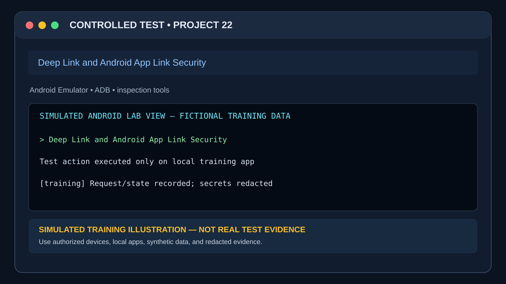
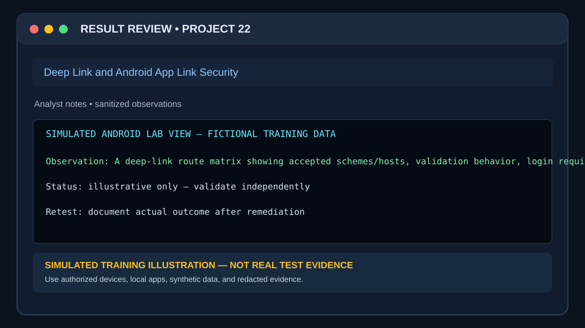

# 22. Deep Link and Android App Link Security

<sub><b>INTERMEDIATE</b> · Android mobile application security testing</sub>

> **SIMULATED TRAINING WALKTHROUGH — NOT REAL TEST EVIDENCE.** Screenshots and sample observations are fictional UI illustrations. Run tests only against your own lab app/device or a target covered by written authorization.

## Objective

Assess URI routing, parameter validation, domain verification, and authentication state across deep links and Android App Links.

## Lab and prerequisites

- Android Studio Emulator or dedicated test device with a disposable test profile.
- An intentionally vulnerable training APK and synthetic test data.
- **Tools:** ADB, Android Studio, JADX, Burp Suite.
- Confirm authorization, package name, APK version/hash, device serial, Android API level, test accounts, and allowed test window.
- Keep the emulator on a host-only or otherwise isolated test network. Snapshot before runtime changes.

## Step 1 — Prepare the target

Install the training APK and verify its identity. Record package/build, device/API level, tool versions, and baseline behavior. Use synthetic accounts and data; do not connect personal or production accounts.

```bash
adb devices -l
adb shell getprop ro.build.version.release
adb shell pm list packages | grep -F 'com.example.training'
```

## Step 2 — Inspect the implementation

Use JADX/Apktool or the relevant platform tool to identify the manifest, components, configuration, and code paths associated with the feature. Record file/class/method names and the expected security control. Do not modify or republish third-party APKs.

## Step 3 — Perform the controlled test

1. Review manifest intent filters, schemes, hosts, paths, and autoVerify settings.
2. Inspect the link handler and identify parameters that select accounts, records, or privileged actions.
3. Use adb to launch only documented test links on the emulator with synthetic identifiers.
4. Test malformed, missing, duplicate, and unexpected parameters; verify authentication and authorization at the destination.
5. Check domain association files and ensure untrusted links cannot trigger sensitive actions without confirmation.

Example starting point (adapt to the local app and tool version):

```bash
adb shell am start -a android.intent.action.VIEW -d 'https://links.example.test/item/42' com.example.training
```

The command is a lab example. Confirm the exact target and package before execution; do not run it against an unrelated device or service.

## Step 4 — Validate and interpret

Expected training output: A deep-link route matrix showing accepted schemes/hosts, validation behavior, login requirements, and access-control results.

Untrusted links can route users into unsafe flows, expose sensitive records, or trigger actions using attacker-controlled parameters. A manifest flag, static-analysis alert, or isolated log entry is a lead—not a confirmed vulnerability. Validate attacker prerequisites, reachability, affected data/action, actual impact, and relevant positive controls. Record **confirmed**, **not observed**, **false positive**, or **needs further validation**.

## Step 5 — Remediation and retest

Prefer verified HTTPS App Links, validate scheme/host/path and parameters, require authorization for every referenced object, and use confirmation for sensitive actions.

Repeat the same test on the corrected build and supported Android versions. Record before/after behavior, build hash, timestamp, and residual limitations. Do not close a finding solely because a configuration value changed; verify the security property.

## Simulated tool screenshots

> These project-specific images are fictional training illustrations, not genuine ADB/JADX/Burp/Frida output or evidence of a real assessment.







## Evidence and deliverables

- Authorization and scope record; package, build hash, device/API level, and tool versions.
- Reproducible commands/actions and timestamps.
- Sanitized logs, screenshots, relevant source/configuration references, and test account roles.
- Expected versus observed behavior, validated impact, limitations, and remediation owner.
- Retest outcome and residual risk. Never commit credentials, tokens, private keys, personal data, or proprietary APKs without permission.

## Framework references

- Android Developers — Create Deep Links; OWASP MASVS-PLATFORM
- [OWASP Mobile Application Security Verification Standard (MASVS)](https://mas.owasp.org/MASVS/)
- [OWASP Mobile Application Security Testing Guide (MASTG)](https://mas.owasp.org/MASTG/)

## Completion checklist

- [ ] Scope and authorization recorded
- [ ] Lab package/build and device identified
- [ ] Static and/or dynamic test completed safely
- [ ] Evidence sanitized and labeled as real or simulated
- [ ] Finding validated and severity justified
- [ ] Remediation and repeatable retest documented
