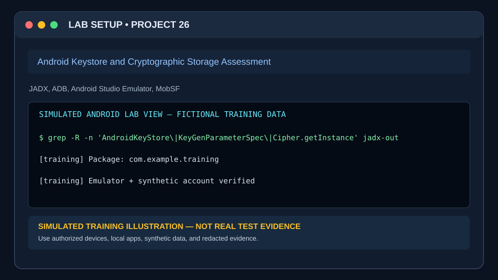
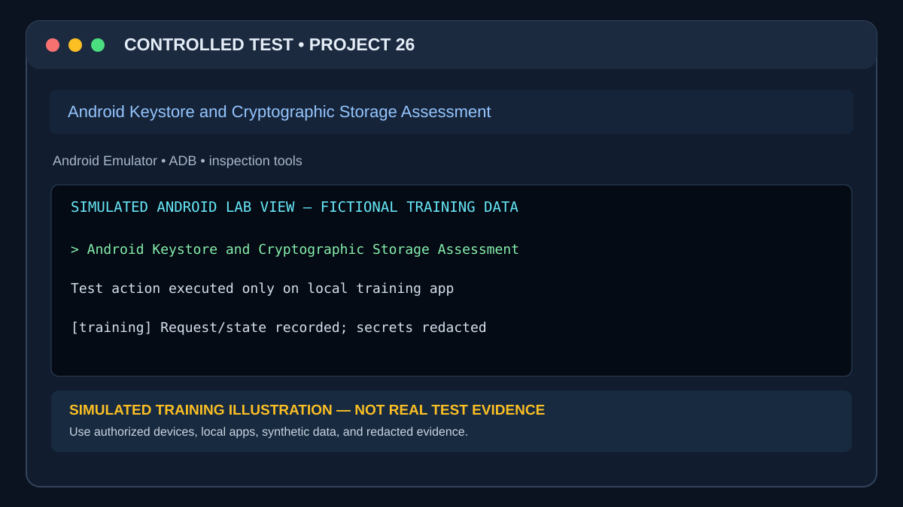
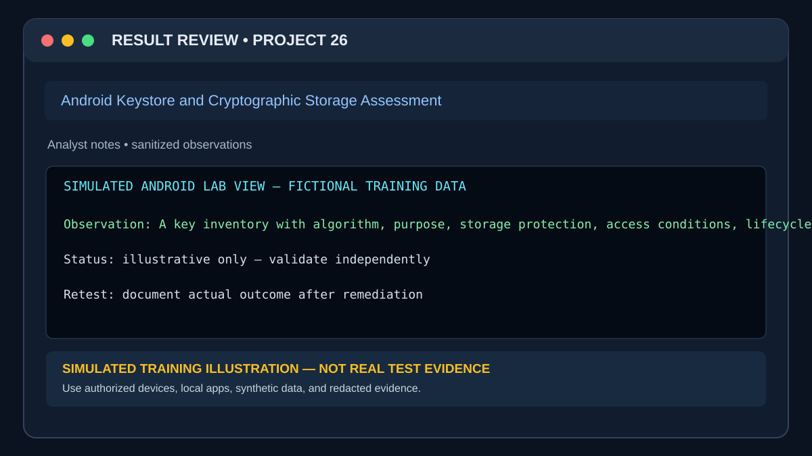

# 26. Android Keystore and Cryptographic Storage Assessment

<sub><b>INTERMEDIATE</b> · Android mobile application security testing</sub>

> **SIMULATED TRAINING WALKTHROUGH — NOT REAL TEST EVIDENCE.** Screenshots and sample observations are fictional UI illustrations. Run tests only against your own lab app/device or a target covered by written authorization.

## Objective

Review how the app generates, stores, uses, and invalidates cryptographic keys and secrets with Android Keystore.

## Lab and prerequisites

- Android Studio Emulator or dedicated test device with a disposable test profile.
- An intentionally vulnerable training APK and synthetic test data.
- **Tools:** JADX, ADB, Android Studio Emulator, MobSF.
- Confirm authorization, package name, APK version/hash, device serial, Android API level, test accounts, and allowed test window.
- Keep the emulator on an isolated test network. Snapshot before runtime changes.

## Step 1 — Prepare the target

Install the training APK and verify its identity. Record package/build, device/API level, tool versions, and baseline behavior. Use synthetic accounts and data; do not connect personal or production accounts.

```bash
adb devices -l
adb shell getprop ro.build.version.release
adb shell pm list packages | grep -F 'com.example.training'
```

## Step 2 — Inspect the implementation

Use JADX/Apktool or the relevant platform tool to identify the manifest, configuration, and code paths associated with the feature. Record file/class/method names and the expected security control. Do not modify or republish third-party APKs.

## Step 3 — Perform the controlled test

1. Locate key generation, alias selection, cipher modes, IV/nonce handling, and key-use call sites.
2. Determine whether key material is exportable or protected by hardware-backed Keystore where supported.
3. Review authentication requirements, key purpose/padding/digest constraints, and backup/migration behavior.
4. Use synthetic data to test expected encrypt/decrypt and key invalidation flows on emulator snapshots.
5. Check logs, preferences, files, and crash output for plaintext secrets or cryptographic material.

Example starting point (adapt to the local app and tool version):

```bash
grep -R -n 'AndroidKeyStore\|KeyGenParameterSpec\|Cipher.getInstance' jadx-out
```

The command is a lab example. Confirm the exact target and package before execution; do not run it against an unrelated device or service.

## Step 4 — Validate and interpret

Expected training output: A key inventory with algorithm, purpose, storage protection, access conditions, lifecycle, and data-at-rest observations.

Weak algorithms, hardcoded keys, or improperly protected key material can expose sensitive local data. A static-analysis alert, manifest attribute, or isolated log entry is a lead—not a confirmed vulnerability. Validate attacker prerequisites, reachability, affected data/action, actual impact, and relevant positive controls. Record **confirmed**, **not observed**, **false positive**, or **needs further validation**.

## Step 5 — Remediation and retest

Use Android Keystore, modern authenticated encryption, unique nonces, key separation, restricted purposes, and documented rotation/invalidation.

Repeat the same test on the corrected build and supported Android versions. Record before/after behavior, build hash, timestamp, and residual limitations.

## Simulated tool screenshots

> These project-specific images are fictional training illustrations, not genuine tool output or evidence of a real assessment.







## Evidence and deliverables

- Authorization and scope record; package, build hash, device/API level, and tool versions.
- Reproducible commands/actions and timestamps.
- Sanitized logs, screenshots, relevant source/configuration references, and test account roles.
- Expected versus observed behavior, validated impact, limitations, remediation owner, and retest outcome.
- Never commit credentials, tokens, private keys, personal data, or proprietary APKs without permission.

## Framework references

- Android Developers — Android Keystore System; OWASP MASVS-CRYPTO
- [OWASP MASVS](https://mas.owasp.org/MASVS/)
- [OWASP MASTG](https://mas.owasp.org/MASTG/)

## Completion checklist

- [ ] Scope and authorization recorded
- [ ] Lab package/build and device identified
- [ ] Test completed safely
- [ ] Evidence sanitized and labeled
- [ ] Finding validated and severity justified
- [ ] Remediation and repeatable retest documented
