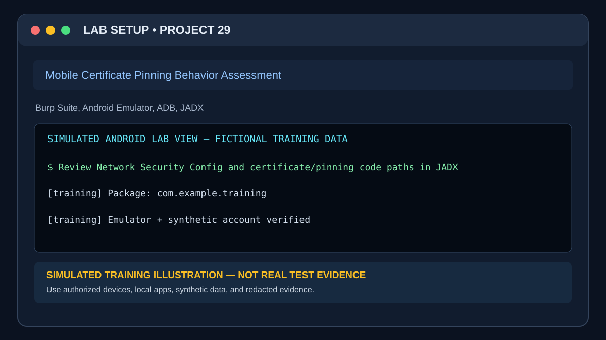
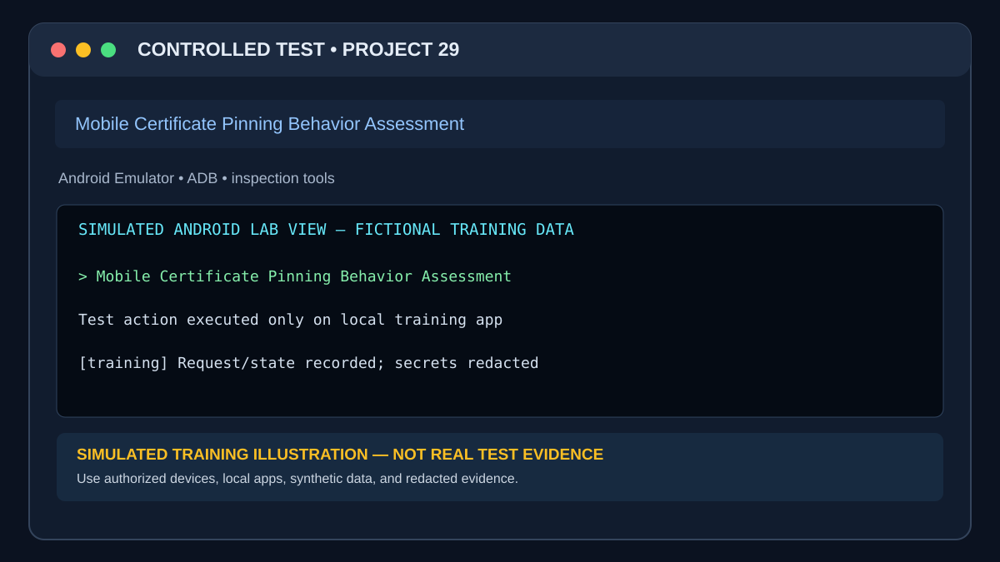
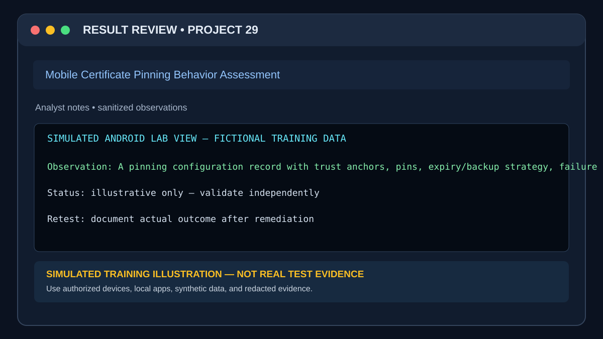

# 29. Mobile Certificate Pinning Behavior Assessment

<sub><b>INTERMEDIATE</b> · Android mobile application security testing</sub>

> **SIMULATED TRAINING WALKTHROUGH — NOT REAL TEST EVIDENCE.** Screenshots and sample observations are fictional UI illustrations. Run tests only against your own lab app/device or a target covered by written authorization.

## Objective

Determine whether certificate pinning is implemented correctly and whether failure behavior is safe in a dedicated test build.

## Lab and prerequisites

- Android Studio Emulator or dedicated test device with a disposable test profile.
- An intentionally vulnerable training APK and synthetic test data.
- **Tools:** Burp Suite, Android Emulator, ADB, JADX.
- Confirm authorization, package name, APK version/hash, device serial, Android API level, test accounts, and allowed test window.
- Keep the emulator on an isolated test network. Snapshot before runtime changes.

## Step 1 — Prepare the target

Install the training APK and verify its identity. Record package/build, device/API level, tool versions, and baseline behavior. Use synthetic accounts and data; do not connect personal or production accounts.

```bash
adb devices -l
adb shell getprop ro.build.version.release
adb shell pm list packages | grep -F 'com.example.training'
```

## Step 2 — Inspect the implementation

Use JADX/Apktool or the relevant platform tool to identify the manifest, configuration, and code paths associated with the feature. Record file/class/method names and the expected security control. Do not modify or republish third-party APKs.

## Step 3 — Perform the controlled test

1. Identify trust configuration, pin sets, backup pins, expiration, and supported API levels.
2. Confirm the test build's network trust path and approved proxy configuration.
3. Use a dedicated emulator and test CA only when the app owner authorizes interception.
4. Observe whether the app rejects untrusted certificates and how it handles pin mismatch.
5. Validate backup pin and certificate-rotation plans; do not bypass protections on third-party apps.

Example starting point (adapt to the local app and tool version):

```bash
Review Network Security Config and certificate/pinning code paths in JADX
```

The command is a lab example. Confirm the exact target and package before execution; do not run it against an unrelated device or service.

## Step 4 — Validate and interpret

Expected training output: A pinning configuration record with trust anchors, pins, expiry/backup strategy, failure mode, and supported-version coverage.

Incorrect pinning or unsafe fallback may weaken transport trust; brittle pinning may cause outages during certificate rotation. A static-analysis alert, manifest attribute, or isolated log entry is a lead—not a confirmed vulnerability. Validate attacker prerequisites, reachability, affected data/action, actual impact, and relevant positive controls. Record **confirmed**, **not observed**, **false positive**, or **needs further validation**.

## Step 5 — Remediation and retest

Use current platform trust APIs, manage backup pins and expiry, protect private keys, and ensure fail-closed behavior with a documented rotation process.

Repeat the same test on the corrected build and supported Android versions. Record before/after behavior, build hash, timestamp, and residual limitations.

## Simulated tool screenshots

> These project-specific images are fictional training illustrations, not genuine tool output or evidence of a real assessment.







## Evidence and deliverables

- Authorization and scope record; package, build hash, device/API level, and tool versions.
- Reproducible commands/actions and timestamps.
- Sanitized logs, screenshots, relevant source/configuration references, and test account roles.
- Expected versus observed behavior, validated impact, limitations, remediation owner, and retest outcome.
- Never commit credentials, tokens, private keys, personal data, or proprietary APKs without permission.

## Framework references

- OWASP MASVS-NETWORK; Android Developers — Network Security Configuration
- [OWASP MASVS](https://mas.owasp.org/MASVS/)
- [OWASP MASTG](https://mas.owasp.org/MASTG/)

## Completion checklist

- [ ] Scope and authorization recorded
- [ ] Lab package/build and device identified
- [ ] Test completed safely
- [ ] Evidence sanitized and labeled
- [ ] Finding validated and severity justified
- [ ] Remediation and repeatable retest documented
