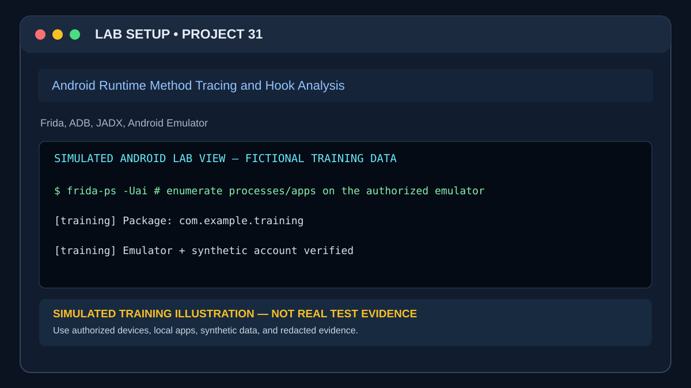
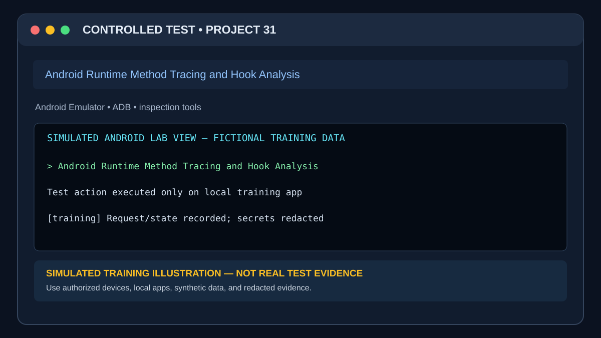
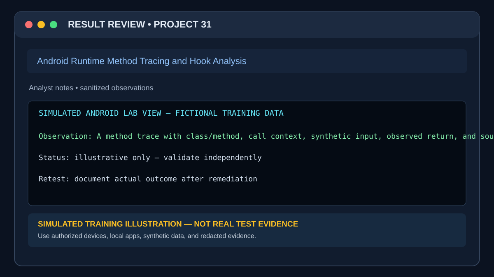

# 31. Android Runtime Method Tracing and Hook Analysis

<sub><b>INTERMEDIATE</b> · Android mobile application security testing</sub>

> **SIMULATED TRAINING WALKTHROUGH — NOT REAL TEST EVIDENCE.** Images and sample observations are fictional UI illustrations. Use only your own lab app/device or a target covered by written authorization.

## Objective

Trace selected app methods at runtime to understand data flow and verify that security-sensitive decisions are enforced beyond the client UI.

## Lab and prerequisites

- Android Studio Emulator or dedicated test device with a disposable test profile.
- An intentionally vulnerable training APK and synthetic test data.
- **Tools:** Frida, ADB, JADX, Android Emulator.
- Confirm authorization, package/build hash, device serial, Android API level, test accounts, and test window.
- Keep the emulator on an isolated network and snapshot it before runtime changes.

## Step 1 — Prepare the target

Install the training APK and verify package identity. Record device/API level, tool versions, baseline behavior, and the exact component under review. Do not use personal or production accounts.

```bash
adb devices -l
adb shell getprop ro.build.version.release
adb shell pm list packages | grep -F 'com.example.training'
```

## Step 2 — Inspect the implementation

Use JADX/Apktool or the relevant platform tool to identify manifest declarations, configuration, and code paths. Record class/method names and the expected security control. Do not alter or redistribute third-party APKs.

## Step 3 — Perform the controlled test

1. Select one benign method in the training app and identify it in JADX.
2. Record app/device ABI and matching Frida client/server versions.
3. Attach to the lab process and trace a non-sensitive method call or owner-provided demo hook.
4. Compare runtime arguments/return values with static source and server-side behavior.
5. Detach, restore the emulator snapshot, and document instrumentation limits.

Example starting point:

```bash
frida-ps -Uai  # enumerate processes/apps on the authorized emulator
```

Adapt the command to your own emulator and tool version. Confirm the target package and scope before execution.

## Step 4 — Validate and interpret

Expected training output: A method trace with class/method, call context, synthetic input, observed return, and source correlation.

Sensitive logic that exists only in the client can be altered or observed by a user controlling the device. A static alert or isolated log line is a lead, not a confirmed vulnerability. Validate prerequisites, reachability, affected data/action, actual impact, and positive controls. Record **confirmed**, **not observed**, **false positive**, or **needs further validation**.

## Step 5 — Remediation and retest

Move authorization and critical business decisions server-side, minimize client secrets, and validate all security-sensitive operations remotely.

Repeat the same test on the corrected build and supported Android versions. Record before/after behavior, build hash, timestamp, and residual limitations.

## Simulated tool screenshots

> Project-specific fictional training illustrations, not genuine tool output or evidence of a real assessment.







## Evidence and deliverables

- Authorization/scope record; package, build hash, device/API level, and tool versions.
- Reproducible commands/actions and timestamps.
- Sanitized logs, screenshots, source/configuration references, and test account roles.
- Expected versus observed behavior, validated impact, limitations, remediation owner, and retest outcome.
- Never commit credentials, tokens, private keys, personal data, or proprietary APKs without permission.

## Framework references

- OWASP MASTG — Dynamic Analysis; Frida documentation
- [OWASP MASVS](https://mas.owasp.org/MASVS/)
- [OWASP MASTG](https://mas.owasp.org/MASTG/)

## Completion checklist

- [ ] Scope and authorization recorded
- [ ] Lab package/build and device identified
- [ ] Test completed safely
- [ ] Evidence sanitized and labeled
- [ ] Finding validated and severity justified
- [ ] Remediation and repeatable retest documented
