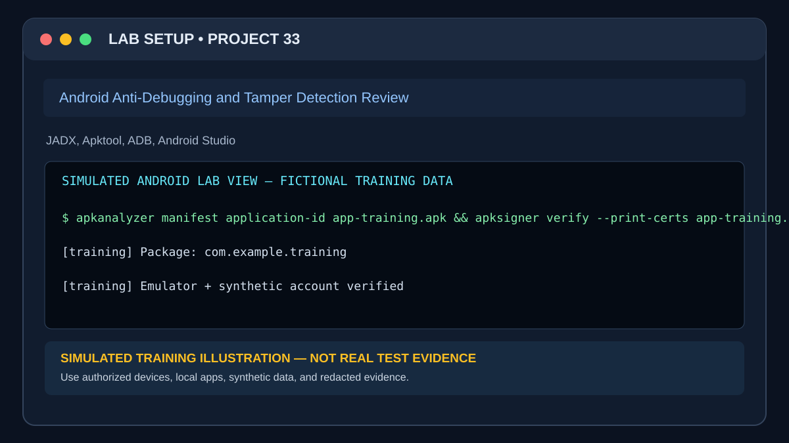
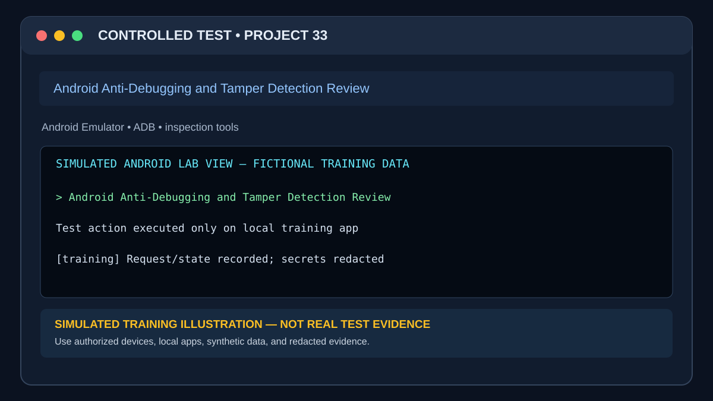
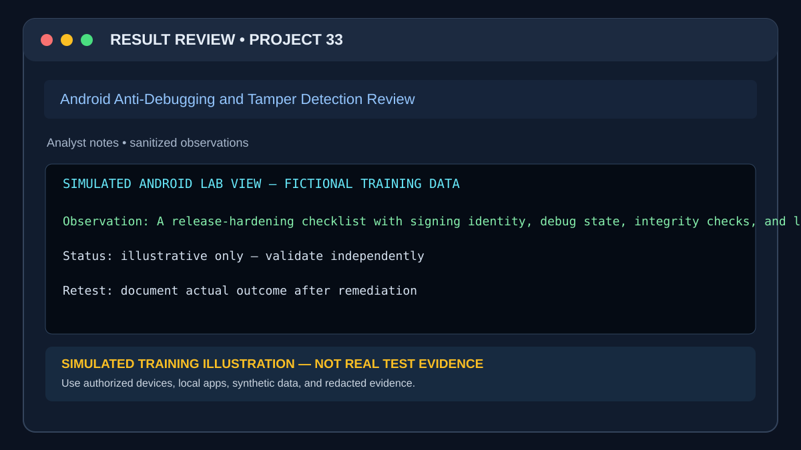

# 33. Android Anti-Debugging and Tamper Detection Review

<sub><b>INTERMEDIATE</b> · Android mobile application security testing</sub>

> **SIMULATED TRAINING WALKTHROUGH — NOT REAL TEST EVIDENCE.** Images and sample observations are fictional UI illustrations. Use only your own lab app/device or a target covered by written authorization.

## Objective

Review debug flags, signing checks, integrity controls, and release-build behavior without treating obfuscation as a security boundary.

## Lab and prerequisites

- Android Studio Emulator or dedicated test device with a disposable test profile.
- An intentionally vulnerable training APK and synthetic test data.
- **Tools:** JADX, Apktool, ADB, Android Studio.
- Confirm authorization, package/build hash, device serial, Android API level, test accounts, and test window.
- Keep the emulator on an isolated network and snapshot it before runtime changes.

## Step 1 — Prepare the target

Install the training APK and verify package identity. Record device/API level, tool versions, baseline behavior, and the exact component under review. Do not use personal or production accounts.

```bash
adb devices -l
adb shell getprop ro.build.version.release
adb shell pm list packages | grep -F 'com.example.training'
```

## Step 2 — Inspect the implementation

Use JADX/Apktool or the relevant platform tool to identify manifest declarations, configuration, and code paths. Record class/method names and the expected security control. Do not alter or redistribute third-party APKs.

## Step 3 — Perform the controlled test

1. Record package identity, signing certificate fingerprint, build type, and debuggable setting.
2. Locate debugger checks, signature verification, integrity checks, and tamper response logic.
3. Compare a developer-signed training build with its expected release configuration.
4. Observe safe warning/telemetry behavior using owner-provided test builds; do not repackage third-party apps.
5. Verify critical APIs and data remain protected even if client-side checks are modified.

Example starting point:

```bash
apkanalyzer manifest application-id app-training.apk && apksigner verify --print-certs app-training.apk
```

Adapt the command to your own emulator and tool version. Confirm the target package and scope before execution.

## Step 4 — Validate and interpret

Expected training output: A release-hardening checklist with signing identity, debug state, integrity checks, and limitations.

Missing integrity checks can ease repackaging or analysis; client-side checks alone cannot protect server-side assets. A static alert or isolated log line is a lead, not a confirmed vulnerability. Validate prerequisites, reachability, affected data/action, actual impact, and positive controls. Record **confirmed**, **not observed**, **false positive**, or **needs further validation**.

## Step 5 — Remediation and retest

Protect signing keys, use reproducible release signing, disable debug features, monitor app integrity, and never rely on obfuscation alone.

Repeat the same test on the corrected build and supported Android versions. Record before/after behavior, build hash, timestamp, and residual limitations.

## Simulated tool screenshots

> Project-specific fictional training illustrations, not genuine tool output or evidence of a real assessment.







## Evidence and deliverables

- Authorization/scope record; package, build hash, device/API level, and tool versions.
- Reproducible commands/actions and timestamps.
- Sanitized logs, screenshots, source/configuration references, and test account roles.
- Expected versus observed behavior, validated impact, limitations, remediation owner, and retest outcome.
- Never commit credentials, tokens, private keys, personal data, or proprietary APKs without permission.

## Framework references

- OWASP MASVS-RESILIENCE; Android Developers — App signing
- [OWASP MASVS](https://mas.owasp.org/MASVS/)
- [OWASP MASTG](https://mas.owasp.org/MASTG/)

## Completion checklist

- [ ] Scope and authorization recorded
- [ ] Lab package/build and device identified
- [ ] Test completed safely
- [ ] Evidence sanitized and labeled
- [ ] Finding validated and severity justified
- [ ] Remediation and repeatable retest documented
