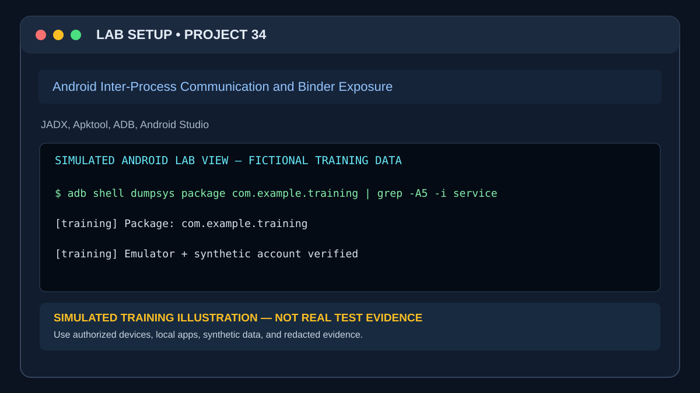
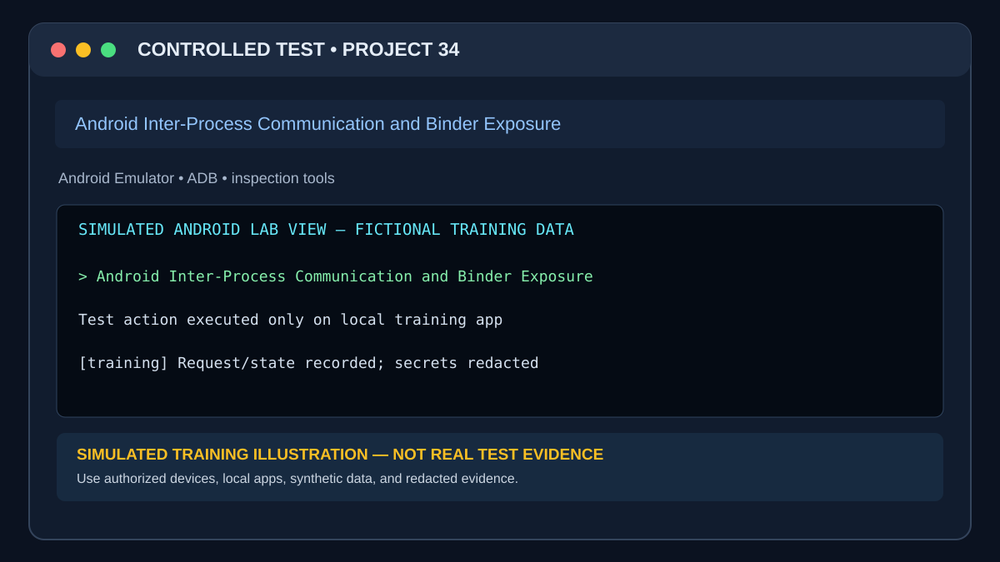
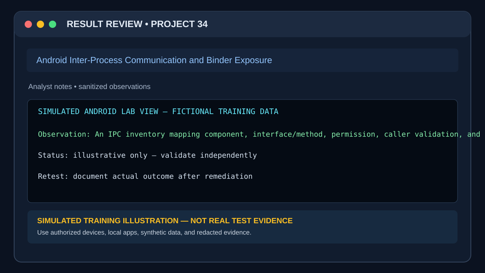

# 34. Android Inter-Process Communication and Binder Exposure

<sub><b>INTERMEDIATE</b> · Android mobile application security testing</sub>

> **SIMULATED TRAINING WALKTHROUGH — NOT REAL TEST EVIDENCE.** Images and sample observations are fictional UI illustrations. Use only your own lab app/device or a target covered by written authorization.

## Objective

Map IPC entry points and verify that exported services, bound interfaces, and Binder methods enforce caller identity and permissions.

## Lab and prerequisites

- Android Studio Emulator or dedicated test device with a disposable test profile.
- An intentionally vulnerable training APK and synthetic test data.
- **Tools:** JADX, Apktool, ADB, Android Studio.
- Confirm authorization, package/build hash, device serial, Android API level, test accounts, and test window.
- Keep the emulator on an isolated network and snapshot it before runtime changes.

## Step 1 — Prepare the target

Install the training APK and verify package identity. Record device/API level, tool versions, baseline behavior, and the exact component under review. Do not use personal or production accounts.

```bash
adb devices -l
adb shell getprop ro.build.version.release
adb shell pm list packages | grep -F 'com.example.training'
```

## Step 2 — Inspect the implementation

Use JADX/Apktool or the relevant platform tool to identify manifest declarations, configuration, and code paths. Record class/method names and the expected security control. Do not alter or redistribute third-party APKs.

## Step 3 — Perform the controlled test

1. Enumerate services, receivers, providers, and custom Binder interfaces from the manifest and source.
2. Map sensitive IPC methods to permission checks and caller identity validation.
3. Exercise only the app's documented test components from an authorized lab harness.
4. Test missing/incorrect permissions and malformed benign arguments; inspect audit logs.
5. Confirm authorization is checked for each sensitive method, not only at binding time.

Example starting point:

```bash
adb shell dumpsys package com.example.training | grep -A5 -i service
```

Adapt the command to your own emulator and tool version. Confirm the target package and scope before execution.

## Step 4 — Validate and interpret

Expected training output: An IPC inventory mapping component, interface/method, permission, caller validation, and test result.

Weak IPC authorization can expose privileged functionality or data to other apps on the device. A static alert or isolated log line is a lead, not a confirmed vulnerability. Validate prerequisites, reachability, affected data/action, actual impact, and positive controls. Record **confirmed**, **not observed**, **false positive**, or **needs further validation**.

## Step 5 — Remediation and retest

Require appropriate permissions, verify Binder caller identity, validate inputs, minimize exported components, and enforce per-operation authorization.

Repeat the same test on the corrected build and supported Android versions. Record before/after behavior, build hash, timestamp, and residual limitations.

## Simulated tool screenshots

> Project-specific fictional training illustrations, not genuine tool output or evidence of a real assessment.







## Evidence and deliverables

- Authorization/scope record; package, build hash, device/API level, and tool versions.
- Reproducible commands/actions and timestamps.
- Sanitized logs, screenshots, source/configuration references, and test account roles.
- Expected versus observed behavior, validated impact, limitations, remediation owner, and retest outcome.
- Never commit credentials, tokens, private keys, personal data, or proprietary APKs without permission.

## Framework references

- Android Developers — AIDL and bound services; OWASP MASVS-PLATFORM
- [OWASP MASVS](https://mas.owasp.org/MASVS/)
- [OWASP MASTG](https://mas.owasp.org/MASTG/)

## Completion checklist

- [ ] Scope and authorization recorded
- [ ] Lab package/build and device identified
- [ ] Test completed safely
- [ ] Evidence sanitized and labeled
- [ ] Finding validated and severity justified
- [ ] Remediation and repeatable retest documented
